# Agent graph

How one conversation turn flows through the LangGraph4j graphs in
[`src/main/java/net/rka/ai/agent`](../src/main/java/net/rka/ai/agent) and
[`.../agent/skills`](../src/main/java/net/rka/ai/agent/skills).
**Keep this file in sync with the `@Graph`, `@Node`, `@Edge`, `@Router`, `@Subgraph` and
`@Subgraphs` annotations, and with the skill files** (see "Keeping this diagram current" below).

The graph has three kinds of subgraphs:

- annotated ones, declared in Java: `approval`, `trusted` and `skillBuilder`;
- **skills** (`skill-<name>`): one subgraph per loaded skill file, built at run time from JSON by
  `SkillGraphBuilder` and added through `@Subgraphs` (see "Skills" below). The coding job is the
  built-in skill `coding`, so its nodes are `skill-coding-*`.

```mermaid
flowchart TD
    START([START]) --> memory["memory<br/><i>summarize: replace old messages<br/>with a summary if too long</i>"]
    memory --> analyze["analyze<br/><i>the model returns the goal and next:<br/>an edge, a tool call or a question<br/>a job edge adds the startCodingJob call</i>"]
    analyze -- "no question" --> agent["agent<br/><i>callModel: ask the model<br/>(summary + recent messages)</i>"]
    analyze -- "question" --> ask{{"⏸ interrupt before ask<br/>Agent asks the Approver<br/>the answer joins the conversation"}}
    ask --> analyze

    agent -- "done<br/>no tool calls<br/>(after 12 tool rounds the model<br/>is asked without tools)" --> END([END])
    agent -- "skill-coding<br/>a startCodingJob call: the model's, the analysis'<br/>or callModel's from a hand edit of code<br/>(one of the skill-* routes)" --> coding_start
    agent -- "skillBuilder<br/>a buildSkill call" --> builder_tools
    agent -- "skill-*<br/>a call of a loaded skill's tool<br/>(skill-NAME)" --> skill_start
    agent -- "tools<br/>only safe calls" --> tools["tools<br/><i>executeTools</i>"]
    agent -- "trusted<br/>every guarded call is trusted<br/>(command or tool:name)" --> trusted_verify
    agent -- "approval<br/>a command or file change<br/>that isn't trusted" --> pause{{"⏸ interrupt before approval<br/>Agent asks the Approver<br/>(dialog / y/N), stores approvals, resumes"}}

    subgraph trusted ["trusted (TrustedGraph)"]
        trusted_verify["verify<br/><i>refuse calls that aren't trusted</i>"]
        trusted_execute["execute<br/><i>run trusted + safe calls</i>"]
        trusted_verify -- "execute" --> trusted_execute
    end

    subgraph approval ["approval (ApprovalGraph)"]
        approval_review["review<br/><i>answer unapproved calls with 'Denied'</i>"]
        approval_execute["execute<br/><i>run approved, trusted + safe calls</i>"]
        approval_review -- "execute" --> approval_execute
    end

    pause --> approval_review

    subgraph skillBuilder ["skillBuilder (SkillBuilderGraph)"]
        builder_tools["tools<br/><i>no model: the request (format, tools,<br/>example, existing skills) + description</i>"]
        builder_draft["draft<br/><i>model: the skill JSON</i>"]
        builder_validate["validate<br/><i>no model: the loader's checks</i>"]
        builder_pause{{"⏸ interrupt before skillBuilder-review<br/>Agent shows the draft:<br/>Save / Revise (comment) / Cancel"}}
        builder_review["review<br/><i>a Revise adds the comment<br/>to the transcript</i>"]
        builder_save["save<br/><i>write ~/chat/skills/name.json</i>"]
        builder_finish["finish<br/><i>answers the buildSkill call</i>"]

        builder_tools --> builder_draft
        builder_draft -- "validate" --> builder_validate
        builder_draft -- "stopped<br/>model error" --> builder_finish
        builder_validate -- "review<br/>valid draft" --> builder_pause
        builder_pause --> builder_review
        builder_validate -- "retry<br/>invalid, fewer than 3 attempts" --> builder_draft
        builder_validate -- "failed<br/>3rd invalid draft" --> builder_finish
        builder_review -- "save" --> builder_save
        builder_review -- "revise<br/>new round of 3 attempts" --> builder_draft
        builder_review -- "cancel<br/>also any unknown answer" --> builder_finish
        builder_save --> builder_finish
    end

    subgraph skill ["skill-* (SkillGraphBuilder, one per skill file; nodes are skill-NAME-NODE)"]
        skill_start["start<br/><i>find the skill's call, answer the<br/>other calls 'Not run', set the inputs</i>"]
        skill_node["the file's nodes<br/><i>model, askUser, branch, set, finish<br/>wired by next / on</i>"]
        skill_ask{{"⏸ interrupt before an askUser node<br/>Agent asks the question,<br/>stores skillAnswer, resumes"}}
        skill_toolStep["toolStep<br/><i>refuse unlisted tools, run safe + trusted calls</i>"]
        skill_toolPause{{"⏸ interrupt before toolApproval<br/>Agent asks the Approver, stores approvals, resumes"}}
        skill_toolApproval["toolApproval<br/><i>deny unapproved calls, run the rest</i>"]
        skill_stopped["stopped<br/><i>error finish: answers the call</i>"]
        skill_finish(["a finish node<br/><i>answers the call</i>"])

        skill_start --> skill_node
        skill_node -. "askUser" .-> skill_ask
        skill_ask --> skill_node
        skill_node -- "tool calls in the reply" --> skill_toolStep
        skill_toolStep -- "calls done<br/>(back to the node)" --> skill_node
        skill_toolStep -- "guarded call left" --> skill_toolPause
        skill_toolPause --> skill_toolApproval
        skill_toolApproval -- "back to the node" --> skill_node
        skill_node -- "stopped<br/>error (the node's on.stopped, else here);<br/>cancelled question, over maxSteps (always here)" --> skill_stopped
        skill_node --> skill_finish
    end

    subgraph coding ["skill-coding (the built-in coding.json; steps in CodingGraph)"]
        coding_start["start<br/><i>find the startCodingJob call</i>"]
        coding_environment["environment<br/><i>goal, fresh job state, cached environment,<br/>the folder's files (project map)</i>"]
        coding_roadmap["roadmap<br/><i>model (low effort): is the goal big? {milestones: [...]},<br/>empty for a goal that is one change</i>"]
        coding_big{"big<br/><i>branch: 2 or more steps?</i>"}
        coding_approveRoadmap{{"approveRoadmap<br/><i>askUser: Do these steps / One job instead</i>"}}
        coding_roadmapStart["roadmapStart<br/><i>set: todo = the steps, summary empty</i>"]
        coding_pick["pick, pickTask<br/><i>set: current = first of todo, todo = rest;<br/>task = this one step of the whole goal</i>"]
        coding_startWork["startWork<br/><i>set: task = the goal (the free route)</i>"]
        coding_afterWork{"afterWork<br/><i>branch: inside a big job?</i>"}
        coding_mark["mark<br/><i>set: summary + this step and its build check</i>"]
        coding_more{"more<br/><i>branch: steps left?</i>"}
        coding_allDone["allDone<br/><i>finish: every step with its build check</i>"]
        coding_pickFiles["pickFiles<br/><i>model: plan, study or free? which files?<br/>{approach, files: [...]}</i>"]
        coding_gather["gather<br/><i>graph: the outlines of those files</i>"]
        coding_plan["plan<br/><i>model: calls submit_plan (changes by section);<br/>graph: validates it, reads sections it asks for</i>"]
        coding_pause{{"⏸ interrupt before skill-coding-planApproval<br/>Agent shows the plan:<br/>Approve / Revise (comment) / Deny"}}
        coding_planApproval["planApproval<br/><i>records the approved plan, the ledger<br/>and copies of the files (baseline)</i>"]
        coding_revise["revise<br/><i>model: is the comment a question or a change?<br/>a question is answered, a change becomes points</i>"]
        coding_setup["setup<br/><i>graph: the approved setup commands</i>"]
        coding_edit["edit<br/><i>model: the new text of all changes to one file<br/>(calls write_code: one text each); graph applies them<br/>in one write, records them in the ledger</i>"]
        coding_verify["verify<br/><i>graph: the verify commands;<br/>messages mapped to sections</i>"]
        coding_fix["fix<br/><i>model: the new text of a failing section;<br/>graph applies it</i>"]
        coding_report["report<br/><i>graph: the Markdown report, and whether any code changed</i>"]
        coding_explain["explain<br/><i>model: why no code changed, what the user can do</i>"]
        coding_answer["answer<br/><i>the report (+ explanation) = the call's result;<br/>success: + the text for the user</i>"]
        coding_study["study<br/><i>locate: model with read-only tools (generic model node):<br/>finds the code, reads parts whole, answers where the change belongs</i>"]
        coding_work["work<br/><i>model with tools (generic model node, ReAct loop):<br/>open-ended work, no plan</i>"]
        coding_check["check<br/><i>no model: the folder's own build command<br/>(VerifyDefaults) after the work</i>"]
        coding_repair["repair<br/><i>model with tools: fixes what the<br/>failed build check printed (once)</i>"]
        coding_recheck["recheck<br/><i>the same check, once more</i>"]
        coding_workDone["workDone<br/><i>finish: the model's report + the build check = the call's result</i>"]
        coding_stopped["stopped<br/><i>only if a step failed without a report<br/>or over maxSteps</i>"]

        coding_start --> coding_environment
        coding_environment --> coding_roadmap
        coding_roadmap --> coding_big
        coding_big -- "2 or more steps" --> coding_approveRoadmap
        coding_big -- "otherwise<br/>one job" --> coding_pickFiles
        coding_approveRoadmap -- "Do these steps" --> coding_roadmapStart
        coding_approveRoadmap -- "One job instead" --> coding_pickFiles
        coding_roadmapStart --> coding_pick
        coding_pick --> coding_work
        coding_pickFiles -- "done<br/>work that can be planned" --> coding_gather
        coding_pickFiles -- "study<br/>needs the existing code understood first" --> coding_study
        coding_study -- "done" --> coding_gather
        coding_pickFiles -- "free<br/>open-ended work: no plan" --> coding_startWork
        coding_startWork --> coding_work
        coding_work -- "done" --> coding_check
        coding_check -- "passed / none<br/>(no build command)" --> coding_afterWork
        coding_check -- "failing" --> coding_repair
        coding_repair -- "done" --> coding_recheck
        coding_recheck -- "passed / none" --> coding_afterWork
        coding_recheck -- "failing<br/>(stops a big job)" --> coding_workDone
        coding_afterWork -- "a step of a big job that says STEP: done" --> coding_mark
        coding_afterWork -- "STEP: stuck" --> coding_workDone
        coding_afterWork -- "otherwise" --> coding_workDone
        coding_mark --> coding_more
        coding_more -- "steps left" --> coding_pick
        coding_more -- "none left" --> coding_allDone
        coding_allDone -. "a finish: ends the skill" .-> coding_end
        coding_workDone -. "a finish: ends the skill" .-> coding_end
        coding_pickFiles -- "stopped<br/>model error, no JSON twice" --> coding_report
        coding_gather --> coding_plan
        coding_plan -- "read<br/>the plan asked for code (2 rounds at most)" --> coding_plan
        coding_plan -- "approval<br/>valid plan" --> coding_pause
        coding_plan -- "stopped<br/>no valid plan after 2 attempts, model error" --> coding_report
        coding_pause --> coding_planApproval
        coding_planApproval -- "approve" --> coding_setup
        coding_planApproval -- "revise<br/>the user's comment" --> coding_revise
        coding_revise -- "change<br/>the points for the next plan" --> coding_plan
        coding_revise -- "question<br/>answered, same plan asked about again" --> coding_pause
        coding_revise -- "stopped" --> coding_report
        coding_planApproval -- "deny" --> coding_report
        coding_setup -- "done" --> coding_edit
        coding_setup -- "stopped<br/>a setup command failed" --> coding_report
        coding_edit -- "edit<br/>changes pending, or failed ones due<br/>for a second try" --> coding_edit
        coding_edit -- "verify<br/>none pending" --> coding_verify
        coding_edit -- "stopped<br/>model error" --> coding_report
        coding_verify -- "passed" --> coding_report
        coding_verify -- "fix<br/>failed at known places, attempts left" --> coding_fix
        coding_verify -- "failing<br/>no place to repair, or the 3rd failed attempt" --> coding_report
        coding_verify -- "stopped<br/>tool error" --> coding_report
        coding_fix -- "verify<br/>sections repaired" --> coding_verify
        coding_fix -- "revise<br/>a fix in a file the plan doesn't change<br/>(2 times at most)" --> coding_pause
        coding_fix -- "stopped<br/>nothing could be changed, model error" --> coding_report
        coding_report -- "done<br/>code was changed, or the user denied the plan" --> coding_answer
        coding_report -- "unchanged<br/>no code changed (nothing applied, or all taken back)" --> coding_explain
        coding_explain -- "done" --> coding_answer
        coding_answer -. "a terminal kind: ends the skill" .-> coding_end(["END of skill-coding"])
        coding_pickFiles -. "any node: over maxSteps<br/>(never a file's own stopped route)" .-> coding_stopped
        coding_stopped --> coding_end
    end

    skill_stopped --> skill_end(["END of skill-*"])
    skill_finish --> skill_end
    skill_end -- "skill-* → agent" --> agent
    coding_end -- "skill-coding → agent" --> agent
    builder_finish -- "skillBuilder → agent" --> agent

    tools -- "analysis asked for it" --> analyze
    tools --> agent
    trusted_execute -- "analysis asked for it" --> analyze
    trusted_execute --> agent
    trusted_verify -- "done<br/>nothing left<br/>(analysis asked for it: analyze)" --> agent
    approval_execute -- "analysis asked for it" --> analyze
    approval_execute --> agent
    approval_review -- "done<br/>everything denied<br/>(analysis asked for it: analyze)" --> agent
```

The coding skill uses the generic nodes for `start` and `stopped` and for the free route (`work` is a generic
`model` node with tools, `workDone` a `finish`): only there do `toolStep` and `toolApproval` run. **On the planned
route the model never calls a tool in a job** (the graph reads, writes and runs; the model only answers with
text). Every file node of a skill has
the same extra routes as in the "skill-*" subgraph above (tool calls → `toolStep`, over `maxSteps` →
`stopped`); they are drawn once there. Every node, `next` and `on` entry of `coding.json` is drawn in
the coding subgraph. The file maps every `stopped` outcome to `report` except `planApproval`'s, which has
none to map; the automatic `stopped` is only reached when a step fails without a report or `maxSteps` is
exceeded (drawn once, from `pickFiles`, but it applies to every node).

## Nodes

| Node | Graph | Defined in | What it does |
|------|-------|------------|--------------|
| `memory` | agent | `AgentGraph.summarize` | Summary memory, once per turn: if the messages after the current summary exceed `MEMORY_SUMMARY_TOKENS`, asks the model to fold the older ones (cut at a user message, keeping about `MEMORY_RECENT_TOKENS` verbatim) into the running summary. Updates `summary` / `summaryCovered`; otherwise no change. |
| `analyze` | agent | `AgentGraph.analyze`, `Analyzer`, `Analysis`, `AnalyzeMessage` | Once per user message, before the agent: sends the conversation as it is (a short constant system message first) with the functions `route(goal, edge)`, `ask_user(question, options)` and the read tools, `tool_choice: required`; the model answers with one function call (`Analysis`). `goal` is the request in one sentence; the call is exactly one of an **edge** (`route`: `agent`, or a job: `job_plan`, `job_study`, `job_free`), a **tool call** (`findParts`, `searchFiles`, `readSection`, `outline`, read-only; its result comes back as the tool message) or a **question** for the user (`ask_user`). What may be chosen is declared on the node with `@Offers` (edges with what each does and when to use it, tool names); `AnalyzeMessage.compose` builds the request from that list and the tool specs, and `Analysis.fromReply` checks the call against the same list (`Offered`). An unusable answer is returned to the model once as an error tool result (or a user note if it answered in text) (`Analyzer`); after two the node changes nothing and the agent goes on. A job edge appends a `startCodingJob(goal)` call, sets the fact `Objective` to the goal and stores the route in `codingRoute` (`plan`, `study`, `free`; `free` means the job picks files without a model call); the `agent` node then has nothing to ask (it returns no update while any call is open) and `route` sends the call to `skill-coding`. A tool edge appends the call (`analyzing` = 1, `analysisTools` + 1, at most `MAX_ANALYSIS_TOOLS` = 4 a turn) and the node `tools` / `trusted` / `approval` returns here (routers `afterTools`, `afterTrusted`, `afterApproval`) with the result in the next message (`tool_results`). A question is stored in `askQuestion` and goes to `ask`. |
| `ask` | agent | `AgentGraph.ask`, `Agent.askAnalysisQuestion` | A pause (interrupt before the node, `ASK_PAUSE`): `Agent` shows the question and its options to the user through the `Approver` (an answer is an option plus an optional comment, or free text), puts the answer into the conversation as a user message (`askAnswer`, `askRounds` + 1) and the graph goes back to `analyze`. At most `MAX_ASKS` = 2 questions a turn; after that `ask` is no longer offered. |
| `agent` | agent | `AgentGraph.callModel` | Sends the system prompt (with the summary appended) + the messages after the summary, and the tool specs (the tools plus one per loaded skill, and `buildSkill`), to the model; appends its reply. After `MAX_AGENT_ROUNDS` (12) rounds of tool calls since the user's message (`State.agentToolRounds`; a skill's or job's own rounds don't count) it sends no tools and asks for an answer, and strips any calls the model makes anyway ("Stopped: too many tool rounds in one turn." when there is no text), so nothing is left open. **An announcement without the call is asked again**: a plain answer that ends on a colon ("Let me make these changes:") is a promise a local model stopped before keeping, so `callModel` (`afterAnnouncement`) acts: where the text names a source or build file ("…changes to ChatWindow.java:") the promised work is a coding job, and the reply gets a `startCodingJob(goal)` call (goal as below) with its text kept; otherwise it asks once more with the answer and a short nudge appended (`AgentGraph.ANNOUNCED_NUDGE`, not stored): the reply's text stays and takes the calls the model now makes, or the model's new answer replaces it, and a new answer that still announces a change to a source file starts the job. **These two job starts happen at most once per turn** (`AgentGraph.jobStartedThisTurn`: a `startCodingJob` call after the user's last message, the model's or triage's, ends them): a job that ended without finishing says why in its report, and starting it again from the reply that follows would loop. **Coding work by hand becomes a job** (`CodingRedirect`, when the coding skill is loaded): if the reply's calls change an *existing* source or build file (`writeFile`, `editSection` of a `.java`, `.py`, `.html`, `package.json`, … file) by more than a tiny change (over 200 characters of new text), or it is the turn's second such change, and the reply has no `startCodingJob` call, the reply's calls are replaced by one `startCodingJob(goal)` call with the user's message as the goal (a short follow-up such as "implement it" brings the earlier user messages along, since a job sees only its goal; the model's text stays), and `route` sends it to `skill-coding` as if the model had asked for it. New files, text and Markdown files, tiny edits and all reading stay direct. |
| `route()` | agent | `AgentGraph.route` | Picks the next step from the reply's unanswered tool calls (first match wins): `skill-coding` if any call is `startCodingJob` (the coding skill's tool; without a loaded `coding` skill it is an ordinary failing tool), `skillBuilder` if any call is `buildSkill`, `skill-<name>` for the first call that is a loaded skill's tool, `approval` if any call needs approval, `trusted` if any risky call is trusted, `tools` for safe calls only, `done` otherwise (which is also how the 12-round cap ends the turn). The `skill-*` routes are added by `@Subgraphs`, one per loaded skill. |
| `tools` | agent | `AgentGraph.executeTools` | Runs calls to tools without `@RequiresApproval`. |
| `trusted` | agent → subgraph | `TrustedGraph` | Risky calls whose `command` matches a trusted command (global + conversation settings); runs without pausing. |
| `trusted/verify` | trusted | `TrustedGraph.verify` | Checks the allow-list again; any call that still needs approval gets an error result. Router `afterVerify`: `execute`, or `done` (nothing left to run). |
| `trusted/execute` | trusted | `TrustedGraph.execute` | Runs the remaining calls. |
| `approval` | agent → subgraph | `ApprovalGraph` | The graph pauses **before** it (`interruptBefore`); `Agent.run` asks the user about the calls that need approval, saves `approvals` in the state and resumes. |
| `approval/review` | approval | `ApprovalGraph.review` | Answers every call that needs approval but wasn't approved with a `Denied:` result. Router `afterReview`: `execute`, or `done` (everything denied). |
| `approval/execute` | approval | `ApprovalGraph.execute` | Runs approved calls plus any trusted or safe calls from the same reply. |
| `skillBuilder` | agent → subgraph | `SkillBuilderGraph` | The skill builder, started by the model's `buildSkill(description)` call (a signal tool that never runs itself). Java, so no skill file can change it. Drafts a skill, checks it by the loader's rules, pauses for the user's review and saves it on Save. |
| `skillBuilder/tools` | skillBuilder | `SkillBuilderGraph.tools` | No model. Takes the description from the call, answers other calls of the reply with "Not run", resets the builder's keys and starts its transcript (`skillMessages`) with the request: the file format and node kinds, the tools a skill may list (without the forbidden ones; marked when they ask for approval or bring web content), one example, the names already taken, the description, and for an existing skill the description asks to change by name ("change the coding skill", "edit release-notes"; a mere mention of the name doesn't count), its current JSON; for a file with coding kinds also their reference (`CodingKinds.builderReference`: kinds, outcomes, the limits they read, the `maxSteps` cap of 1000, the pinned tool). |
| `skillBuilder/draft` | skillBuilder | `SkillBuilderGraph.draft` | One model call without tools over the request (the first message of the transcript), the latest draft and its problems or the user's Revise comment: not every earlier draft, so the request stays the same size round after round and `ContextFittingChatModel` never has to cut the format reference. The answer is the draft (`skillDraft`, a code fence around it is allowed). Its streamed text is hidden ("Drafting the skill"): the review shows it readably. Router `afterDraft`: `validate`, or `stopped` (the model call threw: `finish` reports it). |
| `skillBuilder/validate` | skillBuilder | `SkillBuilderGraph.validate` | No model. The draft must be one JSON object; `"replaces": true` is taken out (it says the draft replaces the existing skill of its name; a taken name needs it, and it needs a skill to replace); the rest must pass `SkillLoader.check` (the real validator, as a user file, plus node-id collisions with the skills of the folder as it is at that moment, `SkillLoader.current`, so a skill saved meanwhile counts). Problems go to `skillDraftErrors` (numbered by attempt) and, while attempts are left, back to the model. Router `afterValidate`: `review` (valid), `retry` (invalid, fewer than 3 attempts in this round), `failed` (3rd invalid draft). |
| `skillBuilder/review` | skillBuilder | `SkillBuilderGraph.review` | The graph pauses **before** it (`interruptBefore`, node id `skillBuilder-review`); `Agent` shows the draft as a `SkillDraft` (the limits, the steps as an outline, prompts, the tools and which of them ask for approval, whether saving replaces a skill, the JSON on request), stores the answer in `skillDecision` / `skillComment` and resumes. A Revise adds the comment to the transcript and clears the round's problems. Router `afterReview`: `save`, `revise` (a new round of 3 attempts), `cancel` (also any missing or unknown answer: fail closed). |
| `skillBuilder/save` | skillBuilder | `SkillBuilderGraph.save` | Writes `~/chat/skills/<name>.json` through a temporary file and a move, never through the file tools (which refuse the skills folder), and only after Save. Overwrites a file only when the draft says `replaces`. `Agent` reloads the skills after the turn, so the turn that saved keeps the graph it started with. |
| `skillBuilder/finish` | skillBuilder | `SkillBuilderGraph.finish` | Answers the `buildSkill` call with what happened (saved, cancelled, still invalid with the last problems, or stopped by a model or save error), flagged as an error unless the skill was saved. |
| `skill-<name>` | agent → dynamic subgraph | `AgentGraph.skills` (`@Subgraphs`), `SkillGraphBuilder` | One per loaded skill, started by the skill's tool (`skill_<name>`, or the `tool` a built-in sets, e.g. `startCodingJob`). Its nodes are inlined as `skill-<name>-<node id>`. The skill has its own transcript (`skillMessages`); the conversation only sees the call and, from the `finish` node, its result. |
| `skill-<name>-start` | skill | `GenericKinds.start` | Built in, every skill has it. No model. Finds the call that started the skill (by the skill's tool) among the open ones, answers the other calls of the reply with "Not run: a skill started; ask again afterwards." (the coding skill's first node answers "Not run" in the coding job's wording), resets the `skill*` keys and sets the variables: `input` (every declared input, `""` when not passed), `goal` (the arguments as text), `folder` (the trusted folder) and, only if some node uses it, `environment`. |
| `skill-<name>-<id>` | skill | `NodeKind.action` of the node's kind | A node of the file. Kinds: `model`, `askUser`, `branch`, `set`, `finish` (see below), and the `coding.*` kinds for the coding skill. Around every kind's action: a new visit sets `skillNode`, counts a step in `skillSteps` and clears the stop reason of the node that sent the skill here; an exception becomes the stop reason, so the call is always answered. Its router goes to: the automatic `stopped` when a dismissed question set `skillStopReason` to "cancelled by the user" (never the node's own `stopped` target: the user ended the skill); the node's `stopped` target (or the automatic `stopped`) when another `skillStopReason` is set; `toolStep` when the reply left tool calls open; the automatic `stopped` when the next visit would exceed `maxSteps` (never a file's own `stopped` target, so a loop can't run on); else the target of the kind's outcome (`next` / `on`). A `finish` ends the subgraph; one that failed without answering goes to `stopped`. |
| `skill-<name>-toolStep` | skill | `GenericKinds.toolStep` | Built in. The open calls of the current node's reply. A call of a tool the node doesn't list (or a forbidden one) gets an error result and never runs. If any other call needs approval (the main graph's rules, `State.needsApproval`, below), none of the batch runs yet: the router sends it to `toolApproval`. Otherwise (safe or trusted) they run. Each visit is one tool round of the node (`skillToolRounds`, against `maxToolRounds`). The router goes back to the node (`skillNode`), to `toolApproval`, or to the stopped target when running threw. |
| `skill-<name>-toolApproval` | skill | `GenericKinds.toolApproval` | Built in. The graph pauses **before** it; `Agent` asks the same `Approver.review` as for the main graph and stores `approvals`. Guarded calls that weren't approved get a "Denied: ... Don't retry it unless the user asks." result (missing counts as no); the approved ones run with the safe and trusted calls of the reply. Unlisted calls are refused again, so an approval can never let one run. Then back to the node. |
| `skill-<name>-stopped` | skill | `GenericKinds.stopped` | Built in, the automatic error finish: answers the skill's call with `Stopped: <skillStopReason>` as an error result, or "too many steps (the skill may take N)" when the step limit sent it here. Then the skill ends. |

### The generic node kinds

Defined in `GenericKinds` (the Javadoc there has the full schema). Every kind also has the outcome
`stopped` (an error, a cancelled question, a limit); unmapped, it goes to the automatic `stopped`.
A cancelled question and the step limit always go to the automatic `stopped`, whatever `on.stopped` says.

| Kind | Fields (\* required) | Outcomes | What it does |
|------|----------------------|----------|--------------|
| `model` | `prompt`\*, `tools`, `output`, `format` (`text` / `json`), `thinking` (`shown` / `progress`), `history` (true: the conversation before the skill goes in front of the prompt as messages, clipped), `maxTokens` (50 to 32000: the longest reply of this node; `skill-coding-study` has 1500), `effort` (`low` / `medium` / `high`: the reasoning effort of this node's requests; the agent's own default is `MODEL_REASONING_EFFORT`, low) | `done` | One model turn. System prompt = the skill's description + a fixed preamble; user message = the rendered prompt. Offered only the tools it lists (minus the forbidden ones). A reply with tool calls goes to `toolStep` and back, the node's conversation growing each round; after `maxToolRounds` rounds, or after a round whose calls all repeated earlier ones (`GenericKinds.repeatedOnly`: a loop), it is asked once more without tools. The final text goes to `output`; with `format: json` it is parsed (a code fence is allowed), with one retry that names the parse error. |
| `askUser` | `question`\*, `choices`\*, `output` | one per choice | The graph pauses **before** it (node id `skill-<name>-<id>`); `Agent` renders `question`, asks the `Approver` and writes `skillAnswer` (`{node, choice, comment}`, `""` when dismissed). A missing or blank choice (dismissed), an answer for another node and an answer a node already used end the skill through the automatic `stopped` ("Stopped: cancelled by the user.", never the node's `on.stopped`); a choice that isn't offered is an error and takes `on.stopped`. The answer goes to `output` as `{choice, comment}`. |
| `branch` | `cases`\* (`{when, then}` list) | each `then`, `otherwise` | The first case whose condition holds gives the outcome; none gives `otherwise`. Changes nothing. |
| `set` | `values`\* (variable → template, `{increment: n}` or `{append: template}`) | `done` | Computes every value from the variables as they were before the node. |
| `finish` | `result`\*, `error`, `say` | none | Answers the skill's call in the conversation with the rendered `result` (an error result when `error` is true). With `say` (a template) the rendered text is also the reply to the user: the `agent` node then makes no model call and the turn ends. Ends the skill. |

Values flow between nodes only through the variables (`skillVars`, a JSON object): `input`, the
built-ins `goal` / `folder` / `environment`, and what nodes set. Templates are `{{var}}`,
`{{var.field}}` and `{{input.<name>}}`; there are no expressions.

### The coding skill (`coding.json`)

The coding job is the built-in skill `coding` (`src/main/resources/net/rka/ai/agent/skills/coding.json`),
started by `startCodingJob(goal)` (its `tool` is pinned to that name; a signal tool that never runs
itself). The file holds the wiring, prompts and limits; each node's kind (`coding.*`, `CodingKinds`) is
implemented by a method of `CodingGraph`. Environment → pickFiles → gather → plan → user approval of the plan →
setup → edit (once per file) → verify → fix (when it fails) → design review → report. A change that needs the existing code understood goes pickFiles → study → gather → plan. Open-ended work (finding out why a build fails, investigating a problem) goes pickFiles → work → workDone instead, with no plan: `work` is a model with tools under the usual rules for calls inside skills, and its report is the call's result. It is a **pipeline, not
a conversation**: the model answers one question per call (which files, the plan, the new text of one
section, what to repair, what is wrong with the design), the graph validates every answer, applies the changes
and runs the commands, and every loop has a limit. The job keeps its data in state keys (the plan, a
**ledger** of its changes), not in a transcript; the conversation only sees the call and, from `report`,
its result. The nodes are `skill-coding-<id>`; their tracing spans are `skill/coding/<id>`. The design is in
`docs/superpowers/specs/2026-10-26-coding-pipeline-design.md`.

| Node | Kind | Defined in | What it does |
|------|------|------------|--------------|
| `skill-coding-environment` | `coding.environment` | `CodingGraph.environment` | No model. Takes the goal (the `start` node found the call), resets the job's state keys and loads the cached environment summary (`~/chat/environment.json`, stale after 7 days, probed again when stale; probes time out after 20 s). It also walks the trusted folder once (`ProjectMap`: per folder its files with their line counts, build output, dependencies and hidden folders left out, at most 400 files / 8,000 characters) into `codingProjectMap`; the job's opening message, which every phase sends, includes it. Its "Not run" answer for the reply's other calls is the coding job's. |
| `skill-coding-pickFiles` | `coding.pickFiles` | `CodingGraph.pickFiles` | A model call that answers `{"approach": "plan | study | free", "files": [...]}` from the project map: how the work goes (`free` = open-ended: it has to be found out as it goes, e.g. why a build or test fails, an investigation; `study` = a feature or change across several places or on top of existing behavior, so exact names and call paths must be read before planning; `plan` = a small, clear change, the default; kept in `codingApproach`), and the existing files the work belongs in, at most 6 (paths that don't exist are dropped; a bare file name that fits one file is accepted). An empty folder asks nothing; an empty list means only new files. An answer that isn't JSON is told back once (`codingPicks`); twice ends the job. Router `afterPickFiles`: `done` (plan), `study`, `free`, `stopped`. The conversation before the job goes in front of the request as messages (`JobHistory`; the `plan` request has it too, the edit and fix requests do not). |
| `skill-coding-gather` | `coding.gather` | `CodingGraph.gather` | No model. The outline of each picked file (`Outlines`: section id, kind, lines, md5; a file with very many sections shows its classes with part counts) into `codingCode`, at most 20,000 characters. |
| `skill-coding-plan` | `coding.plan` | `CodingGraph.plan` | A model call that answers the plan JSON (`CodingPlan`: `changes` naming file, section id, action and intent, `setup` and `verify` commands, optionally `read`) from the outlines. **On a revision the graph keeps what is done** (`CodingGraph.keepDone`): the changes already made, as the approved plan listed them, come first (the ledger keeps them applied, they show ✓), and a change of the new plan that repeats one of them (same file, section and action, about the same intent) is dropped; the model is told the made changes and asked only for what is still to do, so a model that lists the whole job again doesn't make the job do it again. A plan that only asks to `read` sections gets them as text (no model, `codingRead`, at most `maxReadRounds` = 2 times) and is asked again. `PlanValidator` checks the plan against the folder: every file and section exists (a shortened section id becomes the full one; `add` naming a class's header means the class, `add` naming another part means `after` it), at most 12 changes, commands inside the folder that don't write files and don't chain with `&&` or `||` (Windows PowerShell 5 has neither: each command is its own entry, they run in order) (that is a change; a `gradlew` / `gradle` / `mvnw` / `mvn` command becomes the project wrapper's own invocation for this OS, e.g. `.\gradlew.bat build` in PowerShell, when the wrapper is in the working directory: `VerifyDefaults.normalize`), the project's build command filled in when `verify` is empty (`VerifyDefaults`). An unusable answer is told back with the reasons (`maxPlanAttempts` = 2 answers in all). The valid plan is saved as Markdown (the plan file). Its streamed JSON is hidden ("Writing the plan… n characters"). Router `afterPlan`: `approval`, `read`, `stopped`. |
| `skill-coding-planApproval` | `coding.planApproval` | `CodingGraph.planApproval` | The graph pauses **before** it (`interruptBefore`, node id `skill-coding-planApproval`); `Agent` recognizes the pause by the node's kind, shows the plan as a `PlanReview` (made changes marked ✓, failed ✗, and for a revision a "Revised plan: <reason>" line, read before this node clears the reason), stores the answer in `codingDecision` / `codingComment` and resumes. The node records an approved plan in `codingApprovedPlan`, gives the ledger an entry per change (entries of changes already made are kept), and copies the existing files the plan changes (`codingBaseline`, a temporary folder deleted by `report`). Router `afterPlanApproval`: `approve`, `revise`, `deny` (also any missing or unknown answer). |
| `skill-coding-revise` | `coding.revise` | `CodingGraph.revise` | A model call (no tools) that reads the user's comment on a plan against the plan and the outlines and code the job has, and answers `{"kind": "question" \| "change", "points": [...], "answer": "..."}`. A **question** is answered (`codingAnswer`, shown above the plan: `PlanReview.answer`), the comment is cleared and the user is asked about the same plan again: no new plan. A **change** gives `codingPoints` (one per line, the user's own terms): the plan step then puts them first, numbered, calls the old plan "what to change, not what to write again", and refuses a new plan whose changes equal the old one (the job says so in its report instead of showing the same plan as new). A reply that cannot be read counts as a change with the comment as its only point. Outcomes `change` → `plan`, `question` → the pause before `planApproval`, `stopped` → `report`. |
| `skill-coding-setup` | `coding.setup` | `CodingGraph.setup` | No model. Runs the approved setup commands exactly as written, once per job (a revised plan doesn't run them again; `codingSetupDone`). A command that exits non-zero stops the job before anything changes. Router `afterSetup`: `done`, `stopped`. |
| `skill-coding-edit` | `coding.edit` | `CodingGraph.edit` | (A change with an `anchor` — `before` / `after` in a method or constructor of a Java file — is applied by `JavaAnchors`: the anchor must name exactly one line of the method, the statement it starts is found by reading brackets and strings, the new statements are indented like it, and `JavaStructure` checks that the declarations did not change; `PlanValidator` checks the anchor when the plan is read, so a wrong one goes back to the planner.) Imports are added without a model after every change (`JavaImports`: a class name the new code uses and the file does not import is looked up among the project's classes, the JDK's exported packages and the class path's jars; added when exactly one class fits; the log shows `+ imports added` or `⚠ … uses X` for what cannot be told). Every applied change is written to disk at once (`flush`), so a job that stops leaves the files current. When every change is done and some failed while others were applied, each failed change is tried once more (`CodingGraph.retryFailed`, note `second try: …`; the router `afterEdit` goes back to `edit` for it); a patch on its second try is worked as a `replace` the model writes (`CodingGraph.effectivePlan`, worked out from the plan and the ledger on every pass: the approved plan is never changed): an import or member that came later may be what it needed. Makes the next pending change of the ledger together with the other pending changes to the same file (at most 6): ONE model call per file, with each change (action, section, intent, the section's current text; for `add` the class's outline; for `create` a note) and what was made so far in, and one code block per change out, in order (`CodeBlocks.all`; an answer without fences is not code). **The file's style wins**: the request carries what the file shows (`StyleNotes`: indentation, where braces go, whether methods have doc comments, counted from the text), an existing method of the class as an example for `add` (for a new file the first lines of a file of the same kind next to it), and the edit/fix prompts say the style of the surrounding code wins over the design guide, which is only for code where the file shows no convention (the design review reports only a rule the unchanged code of the same file follows). The number of blocks must equal the number of changes, else it is told back once and then every change has a call of its own. The blocks are applied one after the other to the file's text in memory and the file is written once; a change that does not apply stays pending and has a call of its own with the reason. `SectionEdit` applies it (`replace`, `add` placed where its kind belongs, `before`, `after`, and `start` / `end`: statements put right after the opening brace of a method or constructor body, after an explicit `super(...)` / `this(...)` call, or right before the closing brace, before a last `return` / `throw`; only for a method or constructor, checked by `PlanValidator`, so a check inside existing code needs no rewrite of the method); an edit that writes a part twice (the model repeated a neighbour) is refused, a change whose text leaves the file unchanged is refused ("your text changes nothing"), and Java text that starts with a statement (`if (…)`, `return`, a call, an assignment) given for `before` or `after` a method or constructor is applied as the `start` or `end` of its body (statements next to a method can only mean inside it); the same text for `add`, or for replacing a method/constructor/field, is refused. Whether text is a method or statements is decided by the JDK parser (`JavaStructure.readsAsStatements`: a call such as `System.out.println(x);` reads as a method to the lenient reader, but is a statement). Such text would land outside any method, so the model is told to write a whole member instead (`CodingGraph.startsWithStatement`). `delete` needs no model. An answer with no code or an edit that can't be applied is told back once (`maxEditAttempts` = 2 answers per change); then the change is marked **failed** and the job goes on. Router `afterEdit`: `edit` (more pending), `verify`, `stopped` (the model call threw). Its streamed text is hidden ("Writing code… n characters"). |
| `skill-coding-verify` | `coding.verify` | `CodingGraph.verify` | No model. Runs the approved verify commands (a plan without any gets the project's own build command from `VerifyDefaults`; Java files with no build tool are compiled together into a temporary folder, `javac -d …/verify-javac`, so a broken build is never "verified") (`runCommand`, the job's timeout; the working directory must be inside the folder). For a failed run the `file:line` positions of its output (`BuildErrors`) are mapped to the section that holds each line (`codingFixes`). Router `afterVerify`: `passed` (all exit 0, or none planned), `fix` (failed, places to repair, attempts left), `failing` (failed on the `maxVerifyAttempts` = 3rd attempt, or nothing in the output says where to look), `stopped`. Output showing a missing tool marks the environment cache stale. **A design fix can't make things worse**: when the build fails right after one, the plan's files go back to the copies taken when the build passed (`codingGood`), the commands run once more, and the report says the design issues are still open (`codingDesignUndone`). |
| `skill-coding-fix` | `coding.fix` | `CodingGraph.fix` | Repairs `codingFixes` (from verify or the design review): one model call per section (at most 4 sections, all problems of a section in one call): the section's text and its messages in, its new text out (the answer `SKIP` leaves a section as it is: the failing line was only a symptom). An answer that equals the code there is not applied; the call is made once more with the code of the methods the message names (`calleeSources`) and the words that the answer fixed nothing. A finding in a file the plan doesn't change is never edited silently: the plan gets a change for it and the job goes back to the user (`revise`, at most 2 times, `codingRevisions`). When nothing could be changed the job stops with a report instead of verifying the same failure again. Router `afterFix`: `verify`, `revise`, `stopped`. |
| `skill-coding-study` | `model` | `GenericKinds.Model` | **Locate** (`pickFiles` answered `study`): a generic `model` node (low effort) offered only read tools: `outline`, `readSection`, `where` (a name's definitions and uses), `searchFiles`, `findFiles`, `listFiles`. The request is in the user's words, so it looks for the names the code uses, reads the parts that matter **whole** with `readSection` (for "like X" requests X as well) and answers in at most three lines where the change belongs. The answer is not the plan's source: `CodingGraph.gather` collects every `readSection` of this step that came back `complete` (`readWhole`) and gives the plan the code of those parts as they are now ("Code the research read, whole parts"), so the plan is made from code, not from notes about it. The three lines still go into the opening message of the later phases (`CodingGraph.notes`). |
| `skill-coding-work` | `model` | `GenericKinds.Model` | **Free route** (`pickFiles` answered `free`): no plan, no plan approval. A generic `model` node offered `outline`, `readSection`, `editSection`, `readFile`, `listFiles`, `findFiles`, `searchFiles`, `writeFile`, `runCommand` and `downloadFile` (`tools`), `history` (the conversation before the job goes in front of the prompt, `JobHistory`), `maxToolRounds` = 40 rounds, its answer in the variable `result`. Its prompt gives the goal, the folder and the environment and asks for a short report at the end. The generic rules for calls inside skills apply (`toolStep`, `toolApproval`): only listed tools, risky calls such as commands that are not trusted ask the user. No `on.stopped` is mapped, so a model error ends the skill through the automatic `stopped`. |
| `skill-coding-check` | `coding.check` | `CodingGraph.check` | **Free route**, no model. Checks what the work changed, not the folder: the files the work's writing calls changed (`changedPaths`, from the transcript; none changed = no check). The build command is the one of the nearest project above a changed file (`VerifyDefaults.detectFor`: the wrapper, gradle, mvn, npm, cargo, go, run in that project's folder, at most 3 projects); without a build file the trusted folder is compiled as a small plain Java project only when it holds at most 200 Java files (hidden folders, `build`, `target`, `out`, `node_modules` not counted: a home folder is not one). The commands are the program's, never the model's, so they need no approval. It sets the skill variable `check` to "passed", "failed (…): the end of the output", "failed … but its messages name none of the changed files … so it was left alone" (not repaired: it was broken before, or by something else) or why nothing was checked. Router `afterCheck`: `passed`, `none` (nothing changed or known to build, tool missing, failure elsewhere), `failing` (a failure that names a changed file). |
| `skill-coding-repair` | `model` | `GenericKinds.Model` | **Free route**, only after a failed check: a generic `model` node with the editing tools of `work` (no `runCommand`), whose prompt has the goal, the first report (`result`) and the build output (`check`); it fixes what the messages point at and its short report replaces `result`. |
| `skill-coding-recheck` | `coding.check` | `CodingGraph.check` | The same check once more after the repair; whatever it finds goes to `workDone`, so the free route repairs at most once. |
| `skill-coding-roadmap` | `model` | `GenericKinds.Model` | The first question of every job, at low effort and without tools or history: is the goal big (several separate things)? Answers `{"milestones": [...]}` (variable `roadmap`): empty for one change, 2 to 8 sentences that each stand alone for a big goal. Its text shows as progress ("Sizing up the job"), not in the chat. |
| `skill-coding-big` | `branch` | `GenericKinds.Branch` | 2 or more milestones → `approveRoadmap`; otherwise → `pickFiles` (the job as before). |
| `skill-coding-approveRoadmap` | `askUser` | `GenericKinds.AskUser` | ⏸ Shows the steps and asks: `Do these steps` → `roadmapStart`, `One job instead` → `pickFiles`; closing the dialog cancels the job. |
| `skill-coding-roadmapStart`, `skill-coding-pick`, `skill-coding-pickTask`, `skill-coding-startWork` | `set` | `GenericKinds.SetValues` | Variables only, no model: `roadmapStart` sets `todo` (`{"copy": "roadmap.milestones"}`), `summary` and `inRoadmap`; `pick` sets `current` (`{"first": "todo"}`) and `todo` (`{"rest": "todo"}`); `pickTask` sets `task` to "one step of a bigger job (the goal): do only this step now: …"; `startWork` (the free route's entry) sets `task` to the goal. `work` and `repair` use `{{task}}`, never `{{goal}}`. |
| `skill-coding-afterWork`, `skill-coding-mark`, `skill-coding-more`, `skill-coding-allDone` | `branch`, `set`, `branch`, `finish` | `GenericKinds` | After a passing (or unchecked) step: `afterWork` sends a step of a big job to `mark` unless its report says `STEP: stuck` (the step prompt asks every report to end with `STEP: done` or `STEP: stuck` and why: a step that changes nothing passes the build check, so the build alone cannot tell; a stuck step ends the job at `workDone` with the steps already done in front) (adds the step's report and build check to `summary`) and anything else to `workDone`; `more` loops to `pick` while `todo` has entries, then `allDone` answers the call with every step's report. A step whose build still fails after one repair ends at `workDone` with the earlier steps' `summary` in front, so a big job never goes on over a broken build. |
| `skill-coding-workDone` | `finish` | `GenericKinds.Finish` | Answers the `startCodingJob` call with the model's report from `result` (after the steps of a big job already done, `summary`) and the build check (`check`), and says the same to the user (`say`): the `agent` node makes no model call after it. |
| `skill-coding-explain` | `coding.explain` | `CodingGraph.explain` | Only after a job that **changed no code** (nothing applied or everything taken back; not when the user denied the plan). A model call (no tools) over the request and the report: why nothing was changed, in plain words, and two or three things the user can do about it, ending with the question of which they want (`codingExplanation`). A model that cannot be reached leaves the explanation out. |
| `skill-coding-answer` | `coding.answer` | `CodingGraph.answer` | Answers the `startCodingJob` call with the report (and the explanation under "Why nothing was changed, and what the user can do"), told to the agent to pass on shortly and ask what to do; for a job that is over the agent must not carry on changing code. A job that succeeded also adds the text for the user itself (the outcome line and one line per change, `CodingGraph.doneText`): the `agent` node then makes no model call (the last message is an answer already) and the turn ends. Every other end goes to the agent. |
| `skill-coding-report` | `coding.report` | `CodingGraph.report` | Builds the Markdown report (outcome, the last **approved** plan with made ✓ and failed ✗ changes marked, a denied revision labelled "Revised plan (not approved)", the design review, the last verify output), saves it as the plan file and sets `codingOutcome` (`success`, `failed`, `unchanged`). It routes to `explain` when no code changed and to `answer` otherwise. The old behavior of answering the `startCodingJob` call moved to `answer`. Previously it answered the call with the report plus a note that the job is over (the agent must not carry on changing code), flagged as an error unless the job is "Done: every change is made and verified". A terminal kind: it has no outcome, and the subgraph ends after it. Every `stopped` route ends here with the reason from `codingStopReason`, e.g. "Stopped: no valid plan after 2 attempts: ...". **A job whose changes were not shown to build ends by putting the files back** (`CodingGraph.rollBack`; verify still failing after the last attempt, a repair that could change nothing, or any stop or error after edits without a passing verify): the plan's files are copied back from the baseline made at approval, files a `create` change made are removed, and the report says so ("The files are back as they were before the job (n restored, m created files removed)") and marks no change as made; if the copies are missing or a file can't be written, the report says the files keep the changes. |

The file's limits: `maxSteps` 300 (a skill with coding kinds may set up to 1000; other skills up to
200), `maxToolRounds` 12 (the free route's `work`), `maxReadRounds` 2, `maxPlanAttempts` 2, `maxEditAttempts` 2, `maxVerifyAttempts` 3,
`maxDesignRounds` 1. The coding kinds route to `stopped` once `codingStopReason` is set; the built-in file maps
every `stopped` to `report`, except `planApproval`, which has no `stopped` route, so a job always answers its
call. An exception inside a step is caught by the skill graph (`skillStopReason`) and takes the same route.

> **The `java*` tools are not offered to the model** (`ToolRegistry.defaultTools`; `JAVA_TOOLS=true` offers them again): it struggled with them. `JavaTools` and the workspace stay in the code; the workspace still backs `listFiles`, `findFiles`, `searchFiles`, `readFile`, `writeFile`, `patchFile` (now also for Java files) and the outline tools, and the plan's own edits. The `study` and `work` nodes of `coding.json` list only the generic tools.

## Small changes: grounded, and written as patches

A change of a few lines used to cost the same as a big one: files guessed from names, a plan made from outlines, and the model writing the whole section again. Two changes:
- **Likely places.** `gather` (no model) also finds the members the goal is about (`Locator`: the words of the goal against the names and the code of every method, constructor and field of the Java workspace) and adds their code, with the outline id to use, to what the plan is made from ("Likely places for this work"). The planner has seen the code it changes and the code it should match.
- **Files that are not Java count too.** `Locator.findInTextFiles` cuts the text files of the folder (not the build output or other skipped folders) into blocks and adds the blocks that use several words of the goal, without an id (a patch of that file without a section). A picked file that is not Java and shorter than 3000 characters is shown whole in the plan's context, so its patch copies real lines.
- **The `patch` action.** A change may carry `patch`: hunks (lines that stay, `-` lines, `+` lines; `TextPatch`) for a few lines inside a section (a member of a Java file; for another file the whole file when no section is named). `PlanValidator` tries the hunks on the file while the plan is being made: a hunk that fits nowhere or twice, in a section that exists, becomes a `replace` of that section that the model writes (the patch and why it did not fit are in the intent; often the model wrote the text as it will be, not as it is), so one wrong patch does not send the whole plan back; a patch without a section is still told back; the `edit` step applies patches in plan order **without a model call** (`CodingGraph.applyPatches`, then the usual structure and variable checks of a Java change), and a patch that no longer fits fails like any change. The approval window shows the hunks.
- **Test with the real model.** `CodingEval` (not part of the build: `$env:CODING_EVAL = "true"; .\gradlew.bat :test --tests "*CodingEval*"`) runs six simple tasks on scratch projects against the model of `.env` and writes `build/eval/coding-eval.md` with pass or fail, seconds and the final files.

## The task and the first decision

`analyze` (table above) decides the first step of a turn. A job edge replaces the fact "Current task: …" (`Objective`, in the state key `facts`, so it is shown in the Memory window and can be edited there) with the goal of the analysis, and the job's goal is that goal. The older `CodingTriage` (three answers `CODING`, `CONTINUE`, `OTHER`) is kept only as the baseline of the routing evaluation (`RoutingEval`, `gradlew runRouting`, cases in `evals/routing/cases.json`).
The goal of a job that `callModel` or the hand-edit net starts (not the analysis) is built by `CodingRedirect`: a message of 60 characters or more is the goal alone.
For a short one ("plan that", "implement it") the goal is the message plus what happened just before: the nearest earlier
answer of the assistant (a recommendation, up to 3,000 characters) or coding job (its goal and report), and while that is too little to tell what it is about (under 200
characters) the one before it, at most three (`CodingRedirect.earlierWork`). The kept task is added only when that is too little; without any earlier work it is the
earlier user messages (`CodingRedirect.goal`). So "plan that" after a recommendation means the recommendation, not the first request of the conversation. The hand-edit safety net (`CodingRedirect.startCall`) also covers
`patchFile` and the Java edit tools.

## Grooming the context

`ContextGroom.apply` builds what the model sees from the conversation, every time a request is made (`AgentGraph.agentMessages`, the model node of a skill), so the context is groomed after each answer for the next question; the transcript the user reads is not touched and the same messages always give the same text (the model server's cache stays valid). The user's own messages stay whole. What the program said instead of the model (the "a coding job ran in this turn" note, "too many tool rounds", the empty-reply note) becomes "(this turn ended without an answer)", so the model does not imitate it. The model's last two answers stay; older long answers keep their first 300 characters. Then earlier turns' tool results are shortened (`SummaryMemory.compactEarlierTurns`) and reads that were done again or made out of date go (`StaleReads`). Messages keep their places, which summary memory needs. Three more pieces keep the record true:
- **Job ledger** (`JobLedger`): before each model call of the `agent` node, a note of the program lists the coding jobs of earlier turns, each as its goal (from the `startCodingJob` call) and the first line of its report (the outcome the graph wrote: "Done: …", "Stopped: …", "Still failing after …"), the latest four. It is what the model is told about the jobs instead of what it once wrote about them. In the turn where a job just reported, the report itself is the last message and the ledger is left out.
- **Name check** (`NameCheck`): a class-like name in backticks in a final answer that is nowhere in the project's Java code (`JavaWorkspace.mentions`) and that the user did not write is named under the answer ("[Not found in the project: …]"). The note is part of the stored answer, so the user and every later turn see it.
- **Health and reset** (`ConversationHealth`, `ContextReset`, the chip "● Context" in the window): the health reads the last 40 messages for turns the program had to end (limits, empty replies, refused edits), answers with names not in the project, coding jobs that stopped, many failed tool calls and the share of the model's context the conversation fills: OK / watch / drifting, with the reasons in the tooltip and the window. "Reset context" sets the conversation's summary (the existing summary memory, `ConversationSummary`) to a text made by the program: the task, the user's latest messages in their own words and the job ledger, covering all messages so far. Nothing the model wrote is in it; the transcript on screen is unchanged.

## Fresh information

The context holds as little file text as possible, and what it holds is kept true.

- **Whole parts.** Every read returns a whole unit and says what it read. `readSection` answers `[path · id · kind · lines a–b of N · md5 … · complete]` and the code; a part of more than 30,000 characters is not cut: nothing is returned but its smaller parts (id and lines), each of which can be read whole. `searchFiles` and `where` place their matches in the smallest part of the file that holds them (a Java method, constructor or field; a Markdown heading; a block of lines) as `path · id · lines (kind)` with up to three matching lines, so a hit says which unit to read. `readFile` reads a file whole only when it is small (about 150 lines) or has no parts (data, logs); a bigger code file gives its outline, and line ranges stay for files without parts.
- **The built-in coding skill is a short line**: plan, approve, set up, edit each change, build, repair, report. Three kinds are not part of it but stay available to any skill (a user skill can wire them in; the tests run the full variant, `src/test/resources/coding-full.json`): `coding.planCheck` (a model check of the plan: approach, existing mechanism ignored, a question for the user), `coding.intent` (after a passing build: OK, GAP back to `plan`, or ASK the user at `planApproval`) and `coding.designReview` (a review of the new code against the design guide, one repair round). Their outcomes are `ok / revise / ask`, `done / gap / ask` and `fix / done`. What the short line keeps from them without a node: `plan` itself sends a plan back when it creates a Java class that nothing uses (`unusedCreations`; on the last attempt the plan goes to the user with the remark "look at this before you approve", the job does not stop), the verify command is the project's own build (a bare `javac` in a project with a build file becomes it), and a build that fails in more than 3 files the plan doesn't change stops the job instead of planning repairs for them.
- **A plan is a list, so that a refusal is cheap.** The model writes about 11 tokens a second, so a plan with code in it (4,700 tokens once: 8 minutes) that is then refused costs minutes. The plan prompt says: no code, one short intent per change; `PlanValidator` keeps a patch only up to 8 changed lines (`MAX_PATCH_LINES`; a longer one becomes a `replace` that carries the sketch as guidance for the edit step), accepts 13 to 20 changes with the remark "big plan" (`HARD_MAX_CHANGES`; more is refused; the remark and the dead-class remark go to the user as the plan's reason, "look at this before you approve"), and refuses a setup command that changes the build tool's wrapper. `CodingGraph.plan` limits the reply to `PLAN_MAX_TOKENS` (3,500): a reply that fills it is told to be much shorter, as one of the plan attempts. The log says why a plan was refused ("✗ plan refused …").
- **Each phase of a job gets the parts it uses** (`JobPhase`, `JobContext`). The model calls the graph makes itself (`pickFiles`, `plan`, `revise`, `edit`, `fix`, `designReview`, `intent`, `explain`) used to share one opening with the goal, folder, environment, file list, design guide and research notes. Now each phase sends only its parts, in the same order: `pickFiles` goal, folder, file list; `plan` and `revise` add the environment and the notes (6,000 characters); `edit` has goal, folder, the design guide and the notes cut to 3,000; `fix` goal, folder and the notes (3,000); `designReview` goal, folder and the guide; `intent` and `explain` only goal and folder. The phase's own message carries its material (the section, the build's messages, the ledger). Every call logs the sizes, e.g. `ctx edit: goal 0.1k · folder 0.1k · guide 5.2k · notes 3.0k = 8.7k chars (opening)`.
- **Old reads of a tool loop shrink.** `RollingResults` (applied in the model node of a skill, and to the transcript `ToolCallRunner.withoutRepeats` compares against): the results of reads (`readFile`, `readSection`, `outline`, `listFiles`, `findFiles`, `searchFiles`, `findParts`, the `java*` reads) from before the last 4 rounds shrink to a note with the call, its size and the first 400 characters of the result ("returned N characters, shortened … It began: …"); results up to 600 characters, command output and errors stay. Nothing is shortened while the results together are no more than 60,000 characters (`RollingResults.MAX_HELD_CHARS`): rewriting an old message makes the model server read everything after it again.
- **Doubles and outdated reads leave.** `StaleReads` (applied where a request is built: `AgentGraph.agentMessages` and the model node of a skill) replaces the result of a read by a one-line note when the same read was done again later, or when the file (or the type's file) was changed by a later edit, patch or write. Results under 1,500 characters stay. The result is replaced only when a later message makes it wrong or double, so every request after that has the same text and the model server's cache stays valid.
- **A ledger of what was shown.** The state key `knowledge` (`Knowledge`: one line per file, "path TAB version") is updated by every tool node (`ToolCallRunner.runUnanswered` and `runInSkill`) with the versions of the files the calls touched, after they ran: for a Java file the hash of each member's lines, for another file size, modified time and number of lines. Before each model call of the `agent` node the tracked files are compared with how they are now (a look at the tracked files; the Java workspace has them in memory): changes are named in one note at the end of the request ("`src/Ledger.java`: changed Ledger.run(); added Ledger.pause()"), not stored, and the ledger is brought up to date, so a change is said once. What a call changed itself is not a change.
- **The job's outlines.** `gather` records the versions of the picked files; `plan` builds the outlines again, without a model, when one of them changed since (a revised plan after an edit, a file edited while the plan waited).

## Loop check

Every node of every graph (the agent, the approval and trusted subgraphs, the skill and coding subgraphs) runs inside the node wrapper
(`NodeTracing.wrap`), which also runs `LoopWatch` on its result: the state key `loopWatch` holds, per node, a fingerprint of the
node's last result (message texts and tool calls without their ids) and how many times in a row it came. The fourth equal result of a
node stops the run with a `LoopDetectedException`, which `Agent.run` turns into a failed turn that keeps what was done. Nodes without
updates are not counted. The `agent` and `tools` nodes are not watched: their loop ends by itself after `MAX_AGENT_ROUNDS` with an
answer. This is a backstop besides the limits of each loop (verify attempts, plan revisions, tool rounds per step, the run's step limit)
and the check inside a model call (`RepeatGuard`: a model writing the same lines over and over).

## The Java workspace

In a **Java project** (the trusted folder holds `.java` files) the Java files are held in memory by a `JavaWorkspace`
(`net.rka.ai.tools.code.java`, one per folder from `JavaWorkspaces.shared()`, opened the first time a tool or the coding job
asks, watched by a background thread). It is not a graph node but the layer under the file tools and the coding job:

| Part | What it does |
|------|--------------|
| **Units** | Each file is a `JavaUnit`: its text (possibly newer than the file), its outline, the types read from it (`JavaSourceReader` → `JavaClass`, with members in source order, comments, annotations, record components, enum constants), the dotted names it uses, and the `DiskStamp` (modified time, size) of the file when it was read. Every `JavaClass` read holds the **complete text of its file** (`source()`, the same for nested types) and every entity knows its lines in it: `startLine()` / `endLine()` of each type, field, method, constructor, initializer, comment and enum constant (from its comment or annotations to its closing brace or `;`; 1-based, both included), and `Span`s for the header comment, the `package` and each import. `lines(member)` returns those lines of the text; a type built by hand has no text and lines 0. Immutable; every change replaces the unit and reads its types again, so the lines always match the text. A file that doesn't parse keeps its text and outline and the reason (`parseError`). |
| **Indexes** | Hash maps: qualified name → type, simple name → qualified names, word → units using it. Updated per changed unit. `javaFind`, `find`, `typesNamed` are lookups, not searches. |
| **References** | Every dotted name in a unit's declarations and code (`Ledger.parse`, `Map.Entry`, `@Foo`) is resolved the way Java resolves it (types of the same file, single imports, the same package, imports on demand, a nested type after its outer one, fully qualified names) into a `Reference(fromType, fromMember, toType, toMember, kind)` with kind `SUPERTYPE`, `ANNOTATION`, `DECLARATION` (signatures) or `BODY`. Kept per unit and by the type pointed at (`usagesOf`, `referencesOf`, `usersOf`); when a type appears or goes only the units that use its name are resolved again. A call through a variable (`ledger.parse()`) is not resolved to a type (that needs the types of local variables); `possibleCallers` finds those by name among the types that use the type. |
| **Changes in memory** | **Every change is checked against the structure (`JavaStructure`) before it is accepted**, in `edit`, `setText` and the coding job's `apply`: the result must still read as Java, and it must hold exactly the declarations it held, minus those of the part that was replaced, plus those the new text declares (nothing declared twice in a type). A change that fails is refused with what is wrong and nothing is changed, so the model corrects the change instead of repairing a broken file. `edit` (a `SectionEdit` on the text, checked against the md5), `setText` (replace or create), `delete`. The file is not touched. Each change re-reads the unit and updates the indexes and references. |
| **The file system** | `sync()` walks the folder (one walk, stats only; `build`, `.git` and other skipped or hidden folders left out), reads the files whose stamp differs, adds new files, drops deleted ones. The watcher calls it about 40 ms after the last event, tool calls (`ProjectFiles.fresh()`) and every change call it first, and a read calls it when the last look is older than a second. A file that changed on disk **while its unit had changes in memory is a conflict**: both are kept. |
| **Writing** | `flush()` writes the changed units (new files with their folders, deleted ones removed) and takes their new stamps, so the watcher's event for our own write changes nothing. A conflicting unit is left alone and named; `flush(true)` writes over it. `discardAll()` drops the changes in memory and reads the files again. |

**Who goes through it** (`ProjectFiles` decides: a `.java` file of a Java project is memory, every other file is disk):
`outline`, `readSection`, `editSection`, `readFile`, `writeFile`, `listFiles`, `findFiles` and `searchFiles` of the file tools (a listing, a glob and a search show the Java files as they are in memory: new files appear, deleted ones don't, a search finds text not written yet), and `CodingGraph` (reading sections, applying changes, style samples, repair context, finding the section of a compiler message).

**When memory is written to the files** ("the end", and everything that reads the files):
- before every `runCommand` (`TerminalTools`, and `CodingGraph.run` for the job's setup and verify commands: a conflict stops the command, with the file names);
- before the coding job copies the baseline at plan approval, before a plan is checked against the files, and when the design review keeps a good copy;
- at the end of the job (`report`), unless the job took its changes back; files that could not be written because they changed on disk meanwhile are named in the report;
- at the end of every turn (`Agent.run`, in its `finally`), and when the app closes.

When every failed verify command failed because its tool is not installed ("command not found"), the changes were not shown to be wrong: nothing is taken back and the job reports "Done, but not verified". An anchored `before` / `after` whose text declares a method is placed next to the section like a new member.

A job that ends with its build not shown to pass takes its changes back (`rollBack`): the changes in memory are discarded first, then the files are restored from the baseline, then the workspace takes in the restored files.

**Tools** (`JavaTools`, registered with the others): `javaProject` (packages and types, files with changes in memory, conflicts), `javaFind` (a type by simple, qualified or partial name, with its file, supertypes and member signatures), `javaUsages` (which types and members use a type; with `member`, which members may call it), `javaFlush` (write now; `force` over conflicts) `javaDiscard`, and the create/read/update/delete tools that work on the parsed structure (`JavaMembers` finds a member by `name`, `name(int,String)`, `<init>`, `{}` / `static{}` or `Inner.name`; `JavaWorkspace.changeLines` applies the change to the member's lines and `JavaStructure` checks it): `javaOutline` (a type or file as the structure sees it: each member with the name the other tools take and its lines), `javaGraph` (the call graph, see below), `javaRead` (a type or one member), `javaAdd` (new members at the end of a type, indented like its others), `javaReplace` (one member; empty code deletes it), `javaDelete` (a member, or the whole type, and its file when it is alone in it), `javaImport` (add or remove an import) and `javaCreate` (a new file). **Sections** (`JavaOutliner`): the sections of a Java file for `outline`, `readSection` and `editSection` are built from the parsed types (the same lines as every Java tool); only a file that does not read as Java falls back to the older text scan. A test compares both on every Java file of the project. **Patches** (`TextPatch`, the hunk reading and placing for any text; tool `patchFile` for files that are not Java; `JavaPatch`, tool `javaPatch`, for a member of a Java type): a partial change to a member is written as hunks (context lines, `-` lines, `+` lines), found by their context and removed lines (compared without indentation, which must match exactly one place), applied to the member as the file has it, and checked like every change (declarations, variables). The block tools' optional `expect` is the same protection for an address. `JavaWorkspace` and every Java tool refuse a file that is not `.java` (`JavaWorkspace.requireJava`; `javaOutline` says to use `outline`). **Statements** (`JavaBlocks`, `JavaBlockEdit`): a member's body is read with the JDK's parser into `Statement`s (kind, lines with the comments above, `Part`s such as then / else / body / catch, declared `Variable`s with their scope, the names read and written, the `Call`s with their receiver chain; lambdas are parts of the statement that holds them), on first use and kept per text. `javaBlocks` (the tree with addresses), `javaReadBlock` (one statement and the variables visible to it), `javaReplaceBlock`, `javaInsertBlock` and `javaDeleteBlock` work on addresses; `JavaBlockEdit` refuses a change whose statement list would not hold what it should, that leaves a variable undeclared that the removed code declared, or declares a name twice where both are visible. `javaFlush`, `javaDiscard`, `javaAdd`, `javaReplace`, `javaDelete`, `javaReplaceBlock`, `javaInsertBlock`, `javaDeleteBlock`, `javaPatch`, `javaImport` and `javaCreate` are `@WritesFiles` (so after a coding job in the same turn the agent can't call them: `NO_CHANGES_AFTER_JOB`); `javaProject`, `javaFind`, `javaUsages`, `javaOutline`, `javaGraph`, `javaBlocks`, `javaReadBlock` and `javaRead` are safe. The `study` and `work` nodes of the coding skill list them. The coding job's `gather` adds to each picked Java file the cross-references of its types ("is used by: …; uses: …").

**The call graph** (`JavaCallGraph`, built per `javaGraph` call from the workspace in a fraction of a second; no state kept): the methods, constructors and initializers of every type with the members their code calls. A call is resolved from what the code says about its receiver: a local variable, parameter or field with a declared type, a type name (static call), `this` / `super`, `new T(...)`, or the result of an earlier call in the chain (the declared return type); an unqualified call looks in the type, its supertypes and the outer types. A call of an interface or abstract method also reaches the methods of the same name and parameter count in all subtypes of the project. Not followed (and counted): calls on the JDK or libraries, on a `var` from a call or a lambda parameter, reflection. `javaGraph` starts at the `main` methods or at a type or member, follows calls or callers up to 8 levels and prints a tree with file and line (a member shown already is marked ↺).

Not kept in memory: non-Java files (they stay with the file tools), a second type of the same qualified name (the first is kept), references through variables.

## Safe, trusted and guarded calls

Which calls are which (`ToolRegistry`; the signal tools `startCodingJob` and `buildSkill`, and the
skills' tools, are routed to their subgraphs before any of this):

- **safe** (read-only, never asks): tools with neither `@RequiresApproval` nor `@WritesFiles`:
  date, math, `systemInfo`, `sshHosts`, `webSearch`, `fetchPage`, `listFacts`, and the reading
  file tools `workFolder`, `listFiles`, `findFiles`, `searchFiles`, `readFile`, `outline`, `readSection` (which refuse any path outside
  the conversation's trusted folder, and any path inside the skills folder).
- **trusted** (runs via the `trusted` subgraph), only while **no web content is in the turn**:
  - a `@RequiresApproval` call whose `command` matches a trusted command (global settings plus the
    conversation's, see `Settings.effective`) and contains no shell syntax
    (`; & | < > `` ` `` $ ( ) { }`, newline);
  - a `@WritesFiles` call whose whole tool is trusted with a `tool:<name>` entry, e.g. `tool:writeFile`.
- **needs approval**: every other `@RequiresApproval` call (`runCommand`, `runRemoteCommand`, `downloadFile`: a file from the internet, saved whole or not at all) and
  every other `@WritesFiles` call (`writeFile`, `editSection`, `createDirectory`, `movePath`, `copyFile`,
  `deletePath`, `remember`, `forget`).

**Web content in the turn** (`State.webContentInTurn`): a result from a `@WebContent` tool
(`webSearch`, `fetchPage`) appears after the latest user message, or in any skill's transcript of this
turn (`skillMessages`, the skills' model replies and tool results; a run starts it empty), so a page a
skill read keeps counting after it has ended (a coding job reads no web: its model has no tools). Web pages can carry instructions aimed at the model, so from then until
the user's next message, nothing that changes files or runs commands happens without asking. The rule
lives in `ToolRegistry.needsApproval` / `isTrusted` and is applied through `State.needsApproval` /
`State.isTrusted` by the router, `trusted/verify`, `approval/review`, `Agent.askApproval` and the
skills' `toolStep` / `toolApproval`, so a call can't slip between them.

**Inside a skill** (any skill but the coding job's steps): the main graph's rules above apply to
every tool call, unchanged.

- A node only runs the tools it lists. The call of any other tool gets an error result, also after
  an approval.
- Never available in a skill, even if listed (the validator rejects the file; `toolStep` refuses
  the call anyway): `startCodingJob`, `buildSkill`, `sshHosts`, `runRemoteCommand` and every
  `skill_*` tool, so a skill can't start a skill, a coding job or the builder, or reach other
  machines. Memory tools (`remember`, `forget`, `listFacts`) only if the node lists them;
  `remember` / `forget` are `@WritesFiles`, so they ask like anywhere else.
- A guarded call (`needsApproval`: not trusted, or web content in the turn) pauses the skill at
  `toolApproval`, before any call of that batch runs, and uses the same `Approver.review` (dialog or
  `y/N`, **Always** (`g` in the CLI) to trust). A trusted or safe call runs at `toolStep` without asking. A file can
  only narrow what a skill may do, never widen it.
- File tools refuse paths inside `~/chat/skills`: skill files change only through the builder's
  Save.

**The free route** (`pickFiles` → `startWork` → `work` → `check` → [`repair` → `recheck`] → `afterWork` → `workDone`; for a big goal `roadmap` → `big` → `approveRoadmap` → `roadmapStart` → [`pick` → `pickTask` → `work` → `check` → … → `afterWork` → `mark` → `more`] → `allDone`) has no plan to approve, but its build is checked by the graph and repaired once; the model works with the tools of a generic `model` node (listed in the table above), and the rules above keep it safe: only listed tools, the trusted folder, and every risky call (a command that is not trusted, web content) asks the user as in the main graph. After a job the agent itself changes no files in the same turn (`NO_CHANGES_AFTER_JOB`).

**Inside a planned coding job** (`coding.*` kinds) none of this applies, because **the model has no tools there**: its
requests carry no tool specification and its answers are text that `CodingGraph` parses (a list of files, the plan
JSON, a code block, a list of issues). The graph does everything else, so there is no path from the model to a
change or a command:

- The user approves the plan, not each call. The plan names the sections to change (file, section id, action) and
  the setup and verify commands; the graph applies exactly those: it reads the section, asks the model for its
  new text and writes it (`SectionEdit`), and it runs the commands exactly as written (through the tool runner,
  with the job's timeout). Nothing else runs.
- Everything stays **inside the trusted folder** (`WorkFolder.resolveInside`, so `..`, absolute paths and symlinks
  out of it fail): checked when the plan is validated and again when a change is applied or a command's working
  directory is used. A command in a plan may not write files (`>`, `tee`, `sed -i`, `Set-Content` ... are
  refused: a file change is a change), so the approval of the changes can't be bypassed by a command.
- `setup`, `edit`, `fix` and `verify` run only when the current plan is the one the user approved last
  (`notApproved`); a changed plan, even a fix that needs another file (it becomes a revised plan the user sees),
  is approved first. The validator rejects any skill file in which those kinds can be reached without passing a
  `coding.planApproval` node's `approve`.
- A repair of a "cannot find symbol", "cannot be applied", "no suitable" or "incompatible types" gets javac's `symbol:` / `location:` / `required:` lines, the outline of the file and its imports (`CodingGraph.existingMembers`), so an invented name becomes a real one. `CodingGraph.unknownClasses` (`JavaUnknownTypes`) only logs a Java change that uses a class found nowhere (not imported, not in the project, not in `java.lang`): a later change of the plan may add its import. A fix only touches sections of files the plan changes. A problem in any other file goes back to the user as a
  revised plan, at most `MAX_REVISIONS` (2) times (`codingRevisions`), then the job stops with a report.
- The user's trusted commands and `tool:` entries are not used in a job: commands run only from the approved
  plan. A job reads no web page (no tools), so it can't bring web content into the turn.
- **Nothing is taken for code that isn't**: the edit and fix steps need their code in a write_code call (or a code block); prose, an
  apology or a question is told back once and never written into a file. An edit that declares a part the file
  already has is refused for the same reason.
- Limits (in `coding.json`): 2 read rounds, 2 plan attempts, 2 edit attempts per change, 3 verify attempts per
  job, 1 design round, 300 node visits (`maxSteps`). The graph's recursion limit is the larger of 1000 and, for
  each loaded skill, `maxSteps × (2 × maxToolRounds + 2) + 100`, so a skill always stops at its own `maxSteps`,
  with an answer, before LangGraph4j stops the run (the default 25 is far too low). The plain agent ↔ tools loop is
  capped separately at 12 tool rounds per turn (`MAX_AGENT_ROUNDS`).
- Plan commands must terminate: the plan prompt forbids dev servers and watch modes (`npm run dev`,
  `gradle bootRun`, `vite`, ...).
- **No silent skipping**: a change that can't be made is marked failed in the ledger, shown as "✗ failed" in the
  plan and reported as "Done with failed changes: ...", flagged as an error.
- **Stopping early**: a model call or command that throws, no valid plan, a failed setup command or a fix that can
  change nothing write `codingStopReason`; every router (except `afterPlanApproval`) has a `stopped` route to
  `report`, so the job always answers its call.

The plan approval can't be wired around: the validator rejects any skill with coding kinds in which
`coding.setup`, `coding.edit`, `coding.fix` or `coding.verify` can be reached from `start` or from a
`coding.plan` node without passing a `coding.planApproval` node's `approve` outcome, or in which a path from
`start` reaches another coding node before `coding.environment`; and the kinds enforce the approved plan at run
time whatever the wiring.

## State keys

`AgentGraph.State` also holds the analysis: `askQuestion` (JSON of the question and options while the graph waits at `ask`), `askAnswer`, `askRounds` (questions asked this turn), `analyzing` (1 while the analysis waits for the result of a tool call), `analysisTools` (tool calls it made this turn) and `codingRoute` (`plan`, `study` or `free`, set by a job edge, read by `CodingGraph.pickFiles`).

`AgentGraph.State`: `messages` (append-only chat history), `approvals` (call id →
approved, written by `Agent` on resume; the main approval, a skill's `toolApproval` and nothing else
use it), two values `Agent` sets at the start of a run from
the effective settings: `workFolder` (the conversation's trusted folder) and `trustedCommands`
(global plus conversation trusted commands, one per line), and the summary memory: `summary`
(text) and `summaryCovered` (how many messages it replaces), loaded from the conversation and
updated by the `memory` node.

**Skill keys** (used by the `skill-*` subgraphs and, as noted, the builder; `skill-<name>-start`
resets them, so `""` and `0` mean "not set"):

- `skillName`: the running skill's name.
- `skillCallId`: the id of the call that started the skill, answered by its `finish` / `stopped`.
- `skillMessages` (an appender that keeps duplicates) and `skillStart` (where the current run begins
  in it): the skills' own transcript, kept out of `messages`. The conversation never sees it, but it
  counts for `webContentInTurn`.
- `skillVars`: the variables as a JSON object string (`input`, `goal`, `folder`, `environment`, what
  nodes set).
- `skillNode`: the id (inside the skill) of the node running or run last; tool steps return to it.
- `skillSteps`: node visits in this run, against `maxSteps`. `skillToolRounds`: rounds of tool calls in
  the current visit of a `model` node, against `maxToolRounds`.
- `skillAnswer`: the answer to the last `askUser` pause (`{node, choice, comment}`, `""` when
  dismissed), written by `Agent` on every resume from such a pause; the node marks it `used`.
- `skillResult`: the text the skill's finish answered the call with.
- `skillStopReason`: why the skill stopped early (model or tool error, cancelled question, invalid
  JSON answer, exception in a node); `""` while it runs.

**Skill builder keys** (used only by `skillBuilder`, which also uses `skillCallId`, `skillMessages` /
`skillStart` for its drafting transcript, `skillStopReason` for a model error and `skillResult`; its
`tools` node resets all of them): `skillDraft` (the draft JSON, normalized once valid; may start with
`"replaces": true`), `skillDraftErrors` (the round's problems, one `<attempt><TAB><problem>` per line;
`""` once a draft is valid and when a Revise starts a round), `skillDecision` (`save` / `revise` /
`cancel`, written by `Agent` on resume) and `skillComment` (the Revise comment).

The coding job's keys (used only by the coding kinds' nodes; `skill-coding-environment` resets them,
so `""` and `0` mean "not set"): `codingGoal`, `codingCallId` (the `startCodingJob` call to answer, a
copy of `skillCallId`), `codingEnvironment`, `codingProjectMap` (the folder's files with line counts),
`codingPicks` (the picked files, one per line), `codingApproach` (`free` for open-ended work, else ""), `codingCode` (their outlines), `codingRead` (sections the plan
asked to read, as text), `codingReadRounds` and `codingReadPending` (1 while the plan waits to be asked again),
`codingPlan` (JSON; "" while the plan asks to read), `codingPlanRounds` (plans made: what shows a resumed pause
changed something), `codingDecision` (`approve` / `revise` / `deny`, written by `Agent` on resume) and
`codingComment` (the Revise comment), `codingRevisionReason` (why the graph asked for a new plan),
`codingApprovedPlan` (JSON of the plan approved last, what the job works by and the report shows),
`codingLedger` (JSON: per change pending / applied / failed with a note), `codingSetupDone`, `codingAttempts`
(verify runs), `codingVerifyOutput`, `codingFixes` (JSON: the sections to repair with what is wrong, from verify
or the design review), `codingRevisions` (times a fix went back to the user), `codingReport`,
`codingStopReason` (why the job stopped early; set means every router takes `stopped`) and `codingPlanFile`
(the job's Markdown plan file under `~/chat/plans`, chosen by `environment`, written by `plan` with each plan
waiting for approval and by `report` with the final report). The design review adds `codingDesignIssues` (its
findings as a Markdown list), `codingDesignRounds` (reviews run), `codingBaseline` (the folder with the copies
the design review diffs against), `codingGood` (copies of the plan's files while a design fix is tried; "" otherwise)
and `codingDesignUndone` (1 when the fix broke the build and was undone); the edit and fix steps also get the design guide in their prompts.

The conversation's long-term **facts** are the state key `facts` (one `id<TAB>text` per line).
`Agent` sets it at the start of a run and lists the facts in the system prompt; every tool node
(`tools`, `trusted/execute`, `approval/execute`, and a skill's `toolStep` / `toolApproval` when a
listed memory tool ran) returns the facts as `remember` / `forget` left
them (`ToolCallRunner.runUnanswered` / `runInSkill`), and `Agent.run` reads them from the final state.
The same two methods break repeat loops: a call whose result equals that of an identical call (same
tool, same arguments) earlier in the turn (`messages` / `skillMessages` since the last user message)
is answered with a note telling the model to use the earlier result, and a call failing with the same
error as an identical one gets that error plus a note not to repeat it (`ToolCallRunner.withoutRepeats`). In a skill's `model` node a round whose results are all such repeat notes, or all refusals by the user ("Denied: …"), ends tool use for that visit: the model answers instead of proposing another command (`GenericKinds.repeatedOnly`). A turn the user stops can end the graph with a call still open; `Agent.run` answers it with an error result, so the saved conversation stays valid. `FileTools.SKIPPED_FOLDERS` also holds `traces` and `conversations`, and `evals/results` is skipped, so the file list and searches show the project, not the agent's own output; `readSection` reads a part whole only up to 8,000 characters, a bigger one (a whole class) gives its parts.
The router, `trusted/verify` and `approval/review` all decide with `state.needsApproval(...)`,
which combines `trustedCommands` with whether web content is in the turn (derived from `messages`
and `skillMessages`, not stored). Every node that runs tools passes `workFolder` to
them as the `workFolder` invocation parameter: file tools are confined to it, and terminal commands
start there.

## Skills

A **skill** is a JSON file that describes a subgraph made of the app's node kinds. The model starts
it through a tool and gets its result as the tool's answer. The README's "Skills" section describes
the file format for users; this section is how the graph is built.

- **Where skills come from** (`SkillLoader`): the built-ins in the resources
  (`net/rka/ai/agent/skills/<name>.json`; today only `coding`), then the user's `*.json` files in
  `~/chat/skills` (`Settings.globalFile().resolveSibling("skills")`), in file-name order. Each is parsed
  (`SkillFile`) and validated (`SkillValidator`). The file name must be `<name>.json`. A user file with
  a built-in's name **replaces** it: it is a user file for every rule, and keeps the built-in's tool
  (it may repeat it, not change it). An invalid replacement leaves the built-in in place, and its
  errors are listed. A skill whose node ids in the agent graph another skill already has is skipped
  (`skill-a-b` could be skill `a-b` or node `b` of skill `a`); built-ins win. One bad file never stops
  the app or the other skills: the invalid ones are listed with readable errors (Settings, **Skills**;
  an invalid replacement of a built-in reads "Your coding.json can't be used: ... The built-in coding
  skill is used.").
- **A valid file that can't be built** (`AgentGraph.buildable`, `Agent.compile`): each skill's subgraph
  is built once before the graph; one that throws (a kind that fails while its node is made, a node id
  LangGraph4j rejects) is left out and its error listed under its file name; a user file replacing a
  built-in that can't be built gives way to the built-in (if that one builds), like an invalid replacement:
  "... The built-in coding skill is used instead." If the agent graph still
  doesn't compile, it is compiled with the built-in skills only (`SkillLoader.builtInsOnly`; the
  problem is listed under every file left out), and if even that fails, with no skills. Only a graph
  that fails without any skill stops the app.
  Each loaded user skill gets a generated `<name>.md` (Mermaid diagram, prompts, tools; rewritten on
  every load, never read back; a page that doesn't start with the generated marker is left alone).
- **The tool**: `skill_<name>` (`-` becomes `_`), with the skill's description and one string
  parameter per input; only a built-in sets `tool` (the coding skill: `startCodingJob`).
  `ToolRegistry.withSkills` adds these tools to the registry the model sees. They never run: the
  router sends the call to the skill's subgraph.
- **Building the subgraph** (`SkillGraphBuilder.build`): `START → start → <file's start node>`; every
  file node gets a conditional edge from its kind's outcome (via `next` / `on`) and the routes
  described in the node table (`toolStep`, `stopped`); the built-in `toolStep`, `toolApproval` and
  `stopped` complete it. Node ids are the file's ids plus the reserved `start`, `toolStep`,
  `toolApproval` and `stopped`; the parent graph inlines them as `skill-<name>-<id>`. A file's ids start
  with a letter, so none can be LangGraph4j's own `__START__` / `__END__`. The graph
  can't know the skills at compile time, so this is what the `@Subgraphs` extension of the graph
  processor is for.
- **`@Subgraphs`** (`AgentGraph.skills`, `@Subgraphs(prefix = "skill-", returnTo = "agent", router =
  "route")`) is the annotation for a method returning a `Map<String, StateGraph<State>>` of subgraphs
  known only at run time. The generated `AgentGraphDefinition` loops over the map and, for each
  entry, adds the node `skill-<key>`, the edge `skill-<key> → agent` (`returnTo`) and the route
  `skill-<key>` of the conditional edge of the named router (`route`, which returns
  `"skill-<name>"`). With no skills loaded the map is empty and the graph is the same as without.
  The outline shows it as `skill-* = subgraphs skills()` and the route `skill-*: skill-*`.
- **Pauses** (`AgentGraph.compile`, `SkillGraphBuilder.pauseNodes`): the graph is compiled with
  `interruptBefore` `approval`, `skillBuilder-review` and, for every skill, `skill-<name>-toolApproval`,
  every `askUser` node and every `coding.planApproval` node. `Agent` finds out which skill and node a
  paused id is through `SkillLoader.Loaded.nodeIndex()` (never by splitting the id: names contain
  dashes), then asks the matching question: tool approval (`Approver.review`), plan approval
  (`Approver.reviewPlan`), a skill's question (`Approver.askUser`; the window shows a dialog with a
  button per choice, the CLI numbers them) or the builder's draft (`Approver.reviewSkill`: Save /
  Revise with a comment / Cancel; the CLI accepts `s`, `r <comment>` or N). A dismissed question, a
  failing approver, or the default `Approver` finishes the skill with an error result ("cancelled by
  the user").
- **Limits**: `maxSteps` (node visits; default 40, 1 to 200, or up to 1000 with coding kinds) and
  `maxToolRounds` (default 8, 1 to 50) in every file; kinds add their own named limits (the coding
  kinds' `maxReadRounds`, `maxPlanAttempts`, `maxEditAttempts`, `maxVerifyAttempts`,
  `maxDesignRounds`, 1 to 100). A skill that loops stops at `maxSteps` with an error result and the
  conversation keeps the call answered.
- **Reload** (`Agent.reloadSkills`): loads the files again and rebuilds the agent graph and the tool
  list. It runs between turns only: after a turn in which the builder saved a skill, and from the
  **Reload skills** button in Settings (off while a turn runs). A turn in progress keeps the graph it
  started with; a skill that can't be added is left out and listed (above), and only if the graph fails
  without any skill do the skills that were loaded before stay in use.
- **What is shown**: tracing spans are `skill/<name>/<id>` and `skillBuilder/<step>`. The window and
  CLI show each skill's progress as `<skill> · <node> · step n/max` (its node visits against
  `maxSteps`; a coding job's as "Finding the code", "Planning", "Change n/m", "Verifying", ...; the builder's
  as "Skill builder · draft"). A skill's model replies and tool results are passed on as they finish
  (`onJobMessage`, with the skill's name), marked as the skill's, and not saved: the window labels their
  notes with the skill's name. A coding job passes on none: it answers in data (the plan, the ledger), so
  its phases are the progress. Streamed text is hidden by
  node kind (`LiveChannel.hiddenWorkOfKind`, found through the node index so a node may be called
  anything): the `coding.pickFiles`, `coding.plan`, `coding.edit` and `coding.fix` kinds' answers ("Choosing files",
  "Writing the plan", "Writing code", "Fixing code"), the design review's issue list ("Reviewing the design"), and a `model`
  node with `"thinking": "progress"` (`<skill>: <node>`). The builder's `draft` ("Drafting the
  skill") and the `memory` step's summary are hidden too (`LiveChannel.hiddenWork`).

## Other behaviour of a turn

Pauses: `Agent` stops at the checkpoint whose next node is `approval-review` (tool approval,
`APPROVAL_PAUSE`), `skillBuilder-review` (`SKILL_REVIEW_PAUSE`) or one of the skills' pause nodes
(`Compiled.pauses`: `skill-<name>-toolApproval`, an `askUser` node, `skill-coding-planApproval`).
The plan dialog offers Approve, Revise (with a comment) and Deny; the CLI accepts `y`,
`r <comment>` or N. Both show a `PlanReview`: the plan with the steps done so far, and for a revision a
"Revised plan: <reason>" line (the graph's reason, or the user's comment).
`Agent` streams the graph, and shows the job's progress live: a card in the window
("Coding · Step n/m · `cmd`") and lines in the CLI. Each event fires after its node finished, so
"Verifying" appears once the verify commands are done.
The same stream also passes on every message as soon as a node adds it (`Agent.MessageFeed` →
`ProgressListener.onMessage`): the model's replies (thinking, text, tool calls) and tool results of
the conversation, and, marked as a job's or skill's, their own replies and tool results (their prompts
to the model are left out). The window shows them right away and, at the end of the turn, renders
only what wasn't shown yet; the job's and skills' own messages are shown but not saved.
Token-level output (a reply still being generated, a command still running) can't go through the
state, which changes only when a node finishes: the streaming model (`StreamingChatModelAdapter`)
and the tool runner send it to `LiveChannel`, which `Agent` points at the turn's listener. That is
display only; the graph still gets each complete reply and result. A connection that breaks before the
server sent a token ("header parser received no bytes", "closed": the server restarted or dropped the request)
is asked once more after 2 s by the adapter, so a hiccup of the model server doesn't end a job; a break after
the first token, or an answer of the server itself, is not retried.
What is shown follows one rule (`LiveChannel.hiddenWork` and `hiddenWorkOfKind`, used for streamed
tokens and finished messages alike; `NodeTracing` tells the channel which node runs): thinking, the
agent's words, tool calls and results, and a job's findings and step summaries are shown; the plan and
review steps' plan JSON, the design review's list, the builder's draft and the memory step's summary are
not (only a progress line such as "Writing the plan… n characters").

Subgraphs are inlined by LangGraph4j, so their spans in traces are named `trusted/verify`,
`approval/review`, `skillBuilder/draft`, `skill/coding/plan` and so on.

## Keeping this diagram current

Update this file **in the same change** whenever you add, remove or rename a node, edge,
router route, subgraph or skill node kind, change what a router decides, change a built-in skill file
(`coding.json`) or the skill validator's rules or limits, or change which calls count as
safe, trusted or needing approval. To check it:

1. Run `./gradlew compileJava` (`.\gradlew.bat compileJava` on Windows).
2. Compare the diagram with the outlines the graph processor writes in the Javadoc of
   `build/generated/sources/annotationProcessor/java/main/net/rka/ai/agent/*Definition.java`
   (`AgentGraphDefinition`, `ApprovalGraphDefinition`, `TrustedGraphDefinition`,
   `SkillBuilderGraphDefinition`). Every edge and route there must appear here, with the same names.
   The skills are not in the outlines (only as `skill-*`), so compare the built-in skill with its
   file: every node, `next` and `on` entry of `src/main/resources/net/rka/ai/agent/skills/coding.json`
   must appear in the `skill-coding` subgraph, and the generic skill subgraph with
   `SkillGraphBuilder`.
3. Also update the short text diagrams in `README.md` and the `AgentGraph` class Javadoc, and the
   README's "Skills" section (file format, node kinds, limits, safety rules) when the schema changes.
