# Agent graph

How one conversation turn flows through the LangGraph4j graphs in
[`src/main/java/net/rka/ai/agent`](../src/main/java/net/rka/ai/agent) and
[`.../agent/skills`](../src/main/java/net/rka/ai/agent/skills).
**Keep this file in sync with the `@Graph`, `@Node`, `@Edge`, `@Router`, `@Subgraph` and
`@Subgraphs` annotations, and with the skill files** (see "Keeping this diagram current" below).

The graph has three kinds of subgraphs:

- annotated ones, declared in Java: `approval`, `trusted` and `skillBuilder`;
- **skills** (`skill-<name>`): one subgraph per loaded skill file, built at run time from JSON by
  `SkillGraphBuilder` and added through `@Subgraphs` (see "Skills" below). The coding job is the
  built-in skill `coding`, so its nodes are `skill-coding-*`.

```mermaid
flowchart TD
    START([START]) --> memory["memory<br/><i>summarize: replace old messages<br/>with a summary if too long</i>"]
    memory --> agent["agent<br/><i>callModel: ask the model<br/>(summary + recent messages)</i>"]

    agent -- "done<br/>no tool calls<br/>(after 12 tool rounds the model<br/>is asked without tools)" --> END([END])
    agent -- "skill-coding<br/>a startCodingJob call<br/>(one of the skill-* routes)" --> coding_start
    agent -- "skillBuilder<br/>a buildSkill call" --> builder_tools
    agent -- "skill-*<br/>a call of a loaded skill's tool<br/>(skill-NAME)" --> skill_start
    agent -- "tools<br/>only safe calls" --> tools["tools<br/><i>executeTools</i>"]
    agent -- "trusted<br/>every guarded call is trusted<br/>(command or tool:name)" --> trusted_verify
    agent -- "approval<br/>a command or file change<br/>that isn't trusted" --> pause{{"⏸ interrupt before approval<br/>Agent asks the Approver<br/>(dialog / y/N), stores approvals, resumes"}}

    subgraph trusted ["trusted (TrustedGraph)"]
        trusted_verify["verify<br/><i>refuse calls that aren't trusted</i>"]
        trusted_execute["execute<br/><i>run trusted + safe calls</i>"]
        trusted_verify -- "execute" --> trusted_execute
    end

    subgraph approval ["approval (ApprovalGraph)"]
        approval_review["review<br/><i>answer unapproved calls with 'Denied'</i>"]
        approval_execute["execute<br/><i>run approved, trusted + safe calls</i>"]
        approval_review -- "execute" --> approval_execute
    end

    pause --> approval_review

    subgraph skillBuilder ["skillBuilder (SkillBuilderGraph)"]
        builder_tools["tools<br/><i>no model: the request (format, tools,<br/>example, existing skills) + description</i>"]
        builder_draft["draft<br/><i>model: the skill JSON</i>"]
        builder_validate["validate<br/><i>no model: the loader's checks</i>"]
        builder_pause{{"⏸ interrupt before skillBuilder-review<br/>Agent shows the draft:<br/>Save / Revise (comment) / Cancel"}}
        builder_review["review<br/><i>a Revise adds the comment<br/>to the transcript</i>"]
        builder_save["save<br/><i>write ~/chat/skills/name.json</i>"]
        builder_finish["finish<br/><i>answers the buildSkill call</i>"]

        builder_tools --> builder_draft
        builder_draft -- "validate" --> builder_validate
        builder_draft -- "stopped<br/>model error" --> builder_finish
        builder_validate -- "review<br/>valid draft" --> builder_pause
        builder_pause --> builder_review
        builder_validate -- "retry<br/>invalid, fewer than 3 attempts" --> builder_draft
        builder_validate -- "failed<br/>3rd invalid draft" --> builder_finish
        builder_review -- "save" --> builder_save
        builder_review -- "revise<br/>new round of 3 attempts" --> builder_draft
        builder_review -- "cancel<br/>also any unknown answer" --> builder_finish
        builder_save --> builder_finish
    end

    subgraph skill ["skill-* (SkillGraphBuilder, one per skill file; nodes are skill-NAME-NODE)"]
        skill_start["start<br/><i>find the skill's call, answer the<br/>other calls 'Not run', set the inputs</i>"]
        skill_node["the file's nodes<br/><i>model, askUser, branch, set, finish<br/>wired by next / on</i>"]
        skill_ask{{"⏸ interrupt before an askUser node<br/>Agent asks the question,<br/>stores skillAnswer, resumes"}}
        skill_toolStep["toolStep<br/><i>refuse unlisted tools, run safe + trusted calls</i>"]
        skill_toolPause{{"⏸ interrupt before toolApproval<br/>Agent asks the Approver, stores approvals, resumes"}}
        skill_toolApproval["toolApproval<br/><i>deny unapproved calls, run the rest</i>"]
        skill_stopped["stopped<br/><i>error finish: answers the call</i>"]
        skill_finish(["a finish node<br/><i>answers the call</i>"])

        skill_start --> skill_node
        skill_node -. "askUser" .-> skill_ask
        skill_ask --> skill_node
        skill_node -- "tool calls in the reply" --> skill_toolStep
        skill_toolStep -- "calls done<br/>(back to the node)" --> skill_node
        skill_toolStep -- "guarded call left" --> skill_toolPause
        skill_toolPause --> skill_toolApproval
        skill_toolApproval -- "back to the node" --> skill_node
        skill_node -- "stopped<br/>error (the node's on.stopped, else here);<br/>cancelled question, over maxSteps (always here)" --> skill_stopped
        skill_node --> skill_finish
    end

    subgraph coding ["skill-coding (the built-in coding.json; steps in CodingGraph)"]
        coding_start["start<br/><i>find the startCodingJob call</i>"]
        coding_environment["environment<br/><i>goal, fresh job state,<br/>cached environment summary</i>"]
        coding_investigate["investigate<br/><i>model: read-only tools + fixed probes</i>"]
        coding_investigateTools["investigateTools<br/><i>run the allowed calls</i>"]
        coding_plan["plan<br/><i>model: plan JSON</i>"]
        coding_review["review<br/><i>model: check the plan JSON</i>"]
        coding_pause{{"⏸ interrupt before skill-coding-planApproval<br/>Agent shows the plan:<br/>Approve / Revise (comment) / Deny"}}
        coding_planApproval["planApproval<br/><i>records an approved plan;<br/>the router reads the answer</i>"]
        coding_implement["implement<br/><i>model: one plan step per turn;<br/>no item ran → remind once, then skip</i>"]
        coding_implementTools["implementTools<br/><i>plan check, then run;<br/>record the step's items that ran</i>"]
        coding_verify["verify<br/><i>run the plan's verify commands</i>"]
        coding_designReview["designReview<br/><i>check the changed code against the design guide</i>"]
        coding_report["report<br/><i>Markdown report = the call's result</i>"]
        coding_stopped["stopped<br/><i>only if a step failed without a report<br/>or over maxSteps</i>"]

        coding_start --> coding_environment
        coding_environment --> coding_investigate
        coding_investigate -- "tools" --> coding_investigateTools
        coding_investigate -- "plan<br/>findings (6 rounds at most)" --> coding_plan
        coding_investigate -- "stopped<br/>model error" --> coding_report
        coding_investigateTools -- "investigate" --> coding_investigate
        coding_investigateTools -- "stopped<br/>tool error" --> coding_report
        coding_plan -- "review" --> coding_review
        coding_plan -- "stopped<br/>model error" --> coding_report
        coding_review -- "approval<br/>valid plan" --> coding_pause
        coding_pause --> coding_planApproval
        coding_review -- "retry<br/>invalid plan, first time" --> coding_plan
        coding_review -- "stopped<br/>invalid plan twice, model error" --> coding_report
        coding_planApproval -- "approve" --> coding_implement
        coding_planApproval -- "revise" --> coding_plan
        coding_planApproval -- "deny" --> coding_report
        coding_implement -- "tools" --> coding_implementTools
        coding_implement -- "next<br/>step over (done or skipped), more left;<br/>or the same step after a reminder" --> coding_implement
        coding_implement -- "verify<br/>all steps over" --> coding_verify
        coding_implement -- "stopped<br/>over 15 turns in a step, model error" --> coding_report
        coding_implementTools -- "implement<br/>all calls covered by the plan" --> coding_implement
        coding_implementTools -- "revise<br/>a call isn't in the plan" --> coding_plan
        coding_implementTools -- "stopped<br/>tool error" --> coding_report
        coding_verify -- "passed" --> coding_designReview
        coding_verify -- "fix<br/>failed, attempts left" --> coding_implement
        coding_verify -- "failing<br/>failed, 3rd attempt" --> coding_report
        coding_verify -- "stopped<br/>tool error" --> coding_report
        coding_designReview -- "fix<br/>issues found, 1st round" --> coding_implement
        coding_designReview -- "done<br/>no issues, no guide, or 2nd round" --> coding_report
        coding_designReview -- "stopped" --> coding_report
        coding_report -. "a terminal kind: ends the skill" .-> coding_end(["END of skill-coding"])
        coding_investigate -. "any node: over maxSteps<br/>(never a file's own stopped route)" .-> coding_stopped
        coding_stopped --> coding_end
    end

    skill_stopped --> skill_end(["END of skill-*"])
    skill_finish --> skill_end
    skill_end -- "skill-* → agent" --> agent
    coding_end -- "skill-coding → agent" --> agent
    builder_finish -- "skillBuilder → agent" --> agent

    tools --> agent
    trusted_execute --> agent
    trusted_verify -- "done<br/>nothing left" --> agent
    approval_execute --> agent
    approval_review -- "done<br/>everything denied" --> agent
```

The coding skill uses the generic nodes only for `start` and `stopped`: `toolStep` and
`toolApproval` exist in it as in every skill but stay unused, because the coding kinds run their own
tools (the plan check). Every file node of a skill has the same extra routes as in the "skill-*"
subgraph above (tool calls → `toolStep`, over `maxSteps` → `stopped`); they are drawn once there.
Every node, `next` and `on` entry of `coding.json` is drawn in the coding subgraph. The file maps
every `stopped` outcome to `report` except `planApproval`'s, which has none to map; the automatic
`stopped` is only reached when a step fails without a report or `maxSteps` is exceeded (drawn once,
from `investigate`, but it applies to every node).

## Nodes

| Node | Graph | Defined in | What it does |
|------|-------|------------|--------------|
| `memory` | agent | `AgentGraph.summarize` | Summary memory, once per turn: if the messages after the current summary exceed `MEMORY_SUMMARY_TOKENS`, asks the model to fold the older ones (cut at a user message, keeping about `MEMORY_RECENT_TOKENS` verbatim) into the running summary. Updates `summary` / `summaryCovered`; otherwise no change. |
| `agent` | agent | `AgentGraph.callModel` | Sends the system prompt (with the summary appended) + the messages after the summary, and the tool specs (the tools plus one per loaded skill, and `buildSkill`), to the model; appends its reply. After `MAX_AGENT_ROUNDS` (12) rounds of tool calls since the user's message (`State.agentToolRounds`; a skill's or job's own rounds don't count) it sends no tools and asks for an answer, and strips any calls the model makes anyway ("Stopped: too many tool rounds in one turn." when there is no text), so nothing is left open. |
| `route()` | agent | `AgentGraph.route` | Picks the next step from the reply's unanswered tool calls (first match wins): `skill-coding` if any call is `startCodingJob` (the coding skill's tool; without a loaded `coding` skill it is an ordinary failing tool), `skillBuilder` if any call is `buildSkill`, `skill-<name>` for the first call that is a loaded skill's tool, `approval` if any call needs approval, `trusted` if any risky call is trusted, `tools` for safe calls only, `done` otherwise (which is also how the 12-round cap ends the turn). The `skill-*` routes are added by `@Subgraphs`, one per loaded skill. |
| `tools` | agent | `AgentGraph.executeTools` | Runs calls to tools without `@RequiresApproval`. |
| `trusted` | agent → subgraph | `TrustedGraph` | Risky calls whose `command` matches a trusted command (global + conversation settings); runs without pausing. |
| `trusted/verify` | trusted | `TrustedGraph.verify` | Checks the allow-list again; any call that still needs approval gets an error result. Router `afterVerify`: `execute`, or `done` (nothing left to run). |
| `trusted/execute` | trusted | `TrustedGraph.execute` | Runs the remaining calls. |
| `approval` | agent → subgraph | `ApprovalGraph` | The graph pauses **before** it (`interruptBefore`); `Agent.run` asks the user about the calls that need approval, saves `approvals` in the state and resumes. |
| `approval/review` | approval | `ApprovalGraph.review` | Answers every call that needs approval but wasn't approved with a `Denied:` result. Router `afterReview`: `execute`, or `done` (everything denied). |
| `approval/execute` | approval | `ApprovalGraph.execute` | Runs approved calls plus any trusted or safe calls from the same reply. |
| `skillBuilder` | agent → subgraph | `SkillBuilderGraph` | The skill builder, started by the model's `buildSkill(description)` call (a signal tool that never runs itself). Java, so no skill file can change it. Drafts a skill, checks it by the loader's rules, pauses for the user's review and saves it on Save. |
| `skillBuilder/tools` | skillBuilder | `SkillBuilderGraph.tools` | No model. Takes the description from the call, answers other calls of the reply with "Not run", resets the builder's keys and starts its transcript (`skillMessages`) with the request: the file format and node kinds, the tools a skill may list (without the forbidden ones; marked when they ask for approval or bring web content), one example, the names already taken, the description, and for an existing skill the description asks to change by name ("change the coding skill", "edit release-notes"; a mere mention of the name doesn't count), its current JSON; for a file with coding kinds also their reference (`CodingKinds.builderReference`: kinds, outcomes, the limits they read, the `maxSteps` cap of 1000, the pinned tool). |
| `skillBuilder/draft` | skillBuilder | `SkillBuilderGraph.draft` | One model call without tools over the request (the first message of the transcript), the latest draft and its problems or the user's Revise comment: not every earlier draft, so the request stays the same size round after round and `ContextFittingChatModel` never has to cut the format reference. The answer is the draft (`skillDraft`, a code fence around it is allowed). Its streamed text is hidden ("Drafting the skill"): the review shows it readably. Router `afterDraft`: `validate`, or `stopped` (the model call threw: `finish` reports it). |
| `skillBuilder/validate` | skillBuilder | `SkillBuilderGraph.validate` | No model. The draft must be one JSON object; `"replaces": true` is taken out (it says the draft replaces the existing skill of its name; a taken name needs it, and it needs a skill to replace); the rest must pass `SkillLoader.check` (the real validator, as a user file, plus node-id collisions with the skills of the folder as it is at that moment, `SkillLoader.current`, so a skill saved meanwhile counts). Problems go to `skillDraftErrors` (numbered by attempt) and, while attempts are left, back to the model. Router `afterValidate`: `review` (valid), `retry` (invalid, fewer than 3 attempts in this round), `failed` (3rd invalid draft). |
| `skillBuilder/review` | skillBuilder | `SkillBuilderGraph.review` | The graph pauses **before** it (`interruptBefore`, node id `skillBuilder-review`); `Agent` shows the draft as a `SkillDraft` (the limits, the steps as an outline, prompts, the tools and which of them ask for approval, whether saving replaces a skill, the JSON on request), stores the answer in `skillDecision` / `skillComment` and resumes. A Revise adds the comment to the transcript and clears the round's problems. Router `afterReview`: `save`, `revise` (a new round of 3 attempts), `cancel` (also any missing or unknown answer: fail closed). |
| `skillBuilder/save` | skillBuilder | `SkillBuilderGraph.save` | Writes `~/chat/skills/<name>.json` through a temporary file and a move, never through the file tools (which refuse the skills folder), and only after Save. Overwrites a file only when the draft says `replaces`. `Agent` reloads the skills after the turn, so the turn that saved keeps the graph it started with. |
| `skillBuilder/finish` | skillBuilder | `SkillBuilderGraph.finish` | Answers the `buildSkill` call with what happened (saved, cancelled, still invalid with the last problems, or stopped by a model or save error), flagged as an error unless the skill was saved. |
| `skill-<name>` | agent → dynamic subgraph | `AgentGraph.skills` (`@Subgraphs`), `SkillGraphBuilder` | One per loaded skill, started by the skill's tool (`skill_<name>`, or the `tool` a built-in sets, e.g. `startCodingJob`). Its nodes are inlined as `skill-<name>-<node id>`. The skill has its own transcript (`skillMessages`); the conversation only sees the call and, from the `finish` node, its result. |
| `skill-<name>-start` | skill | `GenericKinds.start` | Built in, every skill has it. No model. Finds the call that started the skill (by the skill's tool) among the open ones, answers the other calls of the reply with "Not run: a skill started; ask again afterwards." (the coding skill's first node answers "Not run" in the coding job's wording), resets the `skill*` keys and sets the variables: `input` (every declared input, `""` when not passed), `goal` (the arguments as text), `folder` (the trusted folder) and, only if some node uses it, `environment`. |
| `skill-<name>-<id>` | skill | `NodeKind.action` of the node's kind | A node of the file. Kinds: `model`, `askUser`, `branch`, `set`, `finish` (see below), and the `coding.*` kinds for the coding skill. Around every kind's action: a new visit sets `skillNode`, counts a step in `skillSteps` and clears the stop reason of the node that sent the skill here; an exception becomes the stop reason, so the call is always answered. Its router goes to: the automatic `stopped` when a dismissed question set `skillStopReason` to "cancelled by the user" (never the node's own `stopped` target: the user ended the skill); the node's `stopped` target (or the automatic `stopped`) when another `skillStopReason` is set; `toolStep` when the reply left tool calls open; the automatic `stopped` when the next visit would exceed `maxSteps` (never a file's own `stopped` target, so a loop can't run on); else the target of the kind's outcome (`next` / `on`). A `finish` ends the subgraph; one that failed without answering goes to `stopped`. |
| `skill-<name>-toolStep` | skill | `GenericKinds.toolStep` | Built in. The open calls of the current node's reply. A call of a tool the node doesn't list (or a forbidden one) gets an error result and never runs. If any other call needs approval (the main graph's rules, `State.needsApproval`, below), none of the batch runs yet: the router sends it to `toolApproval`. Otherwise (safe or trusted) they run. Each visit is one tool round of the node (`skillToolRounds`, against `maxToolRounds`). The router goes back to the node (`skillNode`), to `toolApproval`, or to the stopped target when running threw. |
| `skill-<name>-toolApproval` | skill | `GenericKinds.toolApproval` | Built in. The graph pauses **before** it; `Agent` asks the same `Approver.review` as for the main graph and stores `approvals`. Guarded calls that weren't approved get a "Denied: ... Don't retry it unless the user asks." result (missing counts as no); the approved ones run with the safe and trusted calls of the reply. Unlisted calls are refused again, so an approval can never let one run. Then back to the node. |
| `skill-<name>-stopped` | skill | `GenericKinds.stopped` | Built in, the automatic error finish: answers the skill's call with `Stopped: <skillStopReason>` as an error result, or "too many steps (the skill may take N)" when the step limit sent it here. Then the skill ends. |

### The generic node kinds

Defined in `GenericKinds` (the Javadoc there has the full schema). Every kind also has the outcome
`stopped` (an error, a cancelled question, a limit); unmapped, it goes to the automatic `stopped`.
A cancelled question and the step limit always go to the automatic `stopped`, whatever `on.stopped` says.

| Kind | Fields (\* required) | Outcomes | What it does |
|------|----------------------|----------|--------------|
| `model` | `prompt`\*, `tools`, `output`, `format` (`text` / `json`), `thinking` (`shown` / `progress`) | `done` | One model turn. System prompt = the skill's description + a fixed preamble; user message = the rendered prompt. Offered only the tools it lists (minus the forbidden ones). A reply with tool calls goes to `toolStep` and back, the node's conversation growing each round; after `maxToolRounds` rounds it is asked once more without tools. The final text goes to `output`; with `format: json` it is parsed (a code fence is allowed), with one retry that names the parse error. |
| `askUser` | `question`\*, `choices`\*, `output` | one per choice | The graph pauses **before** it (node id `skill-<name>-<id>`); `Agent` renders `question`, asks the `Approver` and writes `skillAnswer` (`{node, choice, comment}`, `""` when dismissed). A missing or blank choice (dismissed), an answer for another node and an answer a node already used end the skill through the automatic `stopped` ("Stopped: cancelled by the user.", never the node's `on.stopped`); a choice that isn't offered is an error and takes `on.stopped`. The answer goes to `output` as `{choice, comment}`. |
| `branch` | `cases`\* (`{when, then}` list) | each `then`, `otherwise` | The first case whose condition holds gives the outcome; none gives `otherwise`. Changes nothing. |
| `set` | `values`\* (variable → template, `{increment: n}` or `{append: template}`) | `done` | Computes every value from the variables as they were before the node. |
| `finish` | `result`\*, `error` | none | Answers the skill's call in the conversation with the rendered `result` (an error result when `error` is true). Ends the skill. |

Values flow between nodes only through the variables (`skillVars`, a JSON object): `input`, the
built-ins `goal` / `folder` / `environment`, and what nodes set. Templates are `{{var}}`,
`{{var.field}}` and `{{input.<name>}}`; there are no expressions.

### The coding skill (`coding.json`)

The coding job is the built-in skill `coding` (`src/main/resources/net/rka/ai/agent/skills/coding.json`),
started by `startCodingJob(goal)` (its `tool` is pinned to that name; a signal tool that never runs
itself). The file holds the wiring, prompts and limits; each node's kind (`coding.*`,
`CodingKinds`) is implemented by a method of `CodingGraph`. Environment → investigate → plan → review →
user approval of the plan → implement → verify → design review → report. The job has its own transcript
(`codingMessages`); the conversation only sees the call and, from `report`, its result. The
nodes are `skill-coding-<id>`; their tracing spans are `skill/coding/<id>`.

| Node | Kind | Defined in | What it does |
|------|------|------------|--------------|
| `skill-coding-environment` | `coding.environment` | `CodingGraph.environment` | No model. Takes the goal (the `start` node found the call), resets the job's state keys and loads the cached environment summary (`~/chat/environment.json`, stale after 7 days, probed again when stale; probes time out after 20 s). Its "Not run" answer for the reply's other calls is the coding job's. |
| `skill-coding-investigate` | `coding.investigate` | `CodingGraph.investigate` | A model turn offered the read-only tools plus `runCommand`. At most 6 rounds of tool calls (`maxInvestigateRounds`), then the model is asked once more without tools, so it always ends with findings. Router `afterInvestigate`: `tools` (calls to run), `plan` (findings written), `stopped` (the model call threw). |
| `skill-coding-investigateTools` | `coding.investigateTools` | `CodingGraph.investigateTools` | Runs only the fixed probe commands (exact match) and read-only tools, plus the user's trusted commands until web content came into the turn (before the job, in it, in an earlier job or skill). Everything else gets an error result naming the probes. Router `afterInvestigateTools`: `investigate`, or `stopped` (a tool run threw). |
| `skill-coding-plan` | `coding.plan` | `CodingGraph.plan` | A model call without tools that answers with the plan JSON (steps with commands and file changes, plus verify commands). On a revision it also gets the previous plan, the user's comment and why the plan must change. Its streamed JSON is hidden ("Writing the plan… n characters"). Router `afterPlan`: `review`, or `stopped` (the model call threw). |
| `skill-coding-review` | `coding.review` | `CodingGraph.review` | A second model call that checks the draft and answers with the corrected plan JSON (hidden: "Reviewing the plan"). Router `afterReview`: `approval` (valid plan), `retry` (invalid, first time), `stopped` (invalid `maxPlanAttempts` = 2 times, or the model call threw: the job reports). A revised plan with fewer steps than are already done is a plan error, like invalid JSON; so is one with exactly the done steps before verify ran (the pending step vanished). |
| `skill-coding-planApproval` | `coding.planApproval` | `CodingGraph.planApproval` | The graph pauses **before** it (`interruptBefore`, node id `skill-coding-planApproval`); `Agent` recognizes the pause by the node's kind, shows the plan as a `PlanReview` (done and skipped steps marked, and for a revision a "Revised plan: <reason>" line, read before `implement` clears the reason), stores the answer in `codingDecision` / `codingComment` and resumes. The node records an approved plan in `codingApprovedPlan`. Router `afterPlanApproval`: `approve`, `revise`, `deny` (also any missing or unknown answer). An approved plan always leaves a step (or, after a failed verify, the fix) to implement. |
| `skill-coding-implement` | `coding.implement` | `CodingGraph.implement` | A model turn on the current plan step (or, after a failed verify, on fixing it). A text answer ends the step, but a step that lists commands or file changes is only **done** when at least one of them ran successfully (`codingDoneItems`); otherwise the model is reminded once, naming them, and a second text answer marks the step **skipped** (`codingSkippedSteps`). Router `afterImplement`: `tools` (calls to check), `next` (step over, more left, or the same step after the reminder), `verify` (all steps over), `stopped` (more than `maxStepTurns` = 15 tool-calling turns in one step, or the model call threw). |
| `skill-coding-implementTools` | `coding.implementTools` | `CodingGraph.implementTools` | The plan check (see below). All covered calls run with the job's command timeout, and the current step's items they carried out (result not an error, `runCommand` with exit code 0) are added to `codingDoneItems`; if any call isn't covered, none runs. Router `afterImplementTools`: `implement` (ran), `revise` (back to `plan` → `review` → the user; done steps are kept), `stopped` (a tool run threw). |
| `skill-coding-verify` | `coding.verify` | `CodingGraph.verify` | No model. Runs the plan's verify commands. Router `afterVerify`: `passed` (all exit 0, or none planned; on to `designReview`), `fix` (failed, back to `implement` in fix mode), `failing` (failed on the `maxVerifyAttempts` = 3rd attempt of the job; re-plans don't reset the count), `stopped` (a run threw). Output showing a missing tool marks the environment cache stale. The "Verifying (attempt n/3)" progress event fires after this node, so it shows once the verify commands have finished. |
| `skill-coding-designReview` | `coding.designReview` | `CodingGraph.designReview` | Once the build passes: the model reads the files the plan created or modified that a design guide is about (`.java` for the Java guide; up to 25 files / 60,000 characters) and checks them against the guide (`DesignGuides`: built-in `guides/java.md` plus the user's `~/chat/guides/<language>.md`, which wins), answering with a JSON list of issues stored as Markdown in `codingDesignIssues` (hidden: "Reviewing the design"). Router `afterDesignReview`: `fix` (issues in the first of `maxDesignRounds` = 2 rounds: back to `implement` in fix mode, limited to what the plan covers, then `verify` again), `done` (no issues, no guide applies, or the last round; remaining issues go into the report, they don't fail the job), `stopped`. A review that can't run, or whose answer isn't a JSON list, is noted as such (never reported as a pass) and never fails the job. Verify attempts after the design fix count from the review (`codingVerifyBase`): a fix that breaks a passing build gets its own 3 attempts, and if it still fails the report says the build passed before the design fixes. |
| `skill-coding-report` | `coding.report` | `CodingGraph.report` | Builds the Markdown report (outcome, the last **approved** plan with done ✓ and skipped ✗ steps marked, a denied revision labelled "Revised plan (not approved)"; a revision that never parsed is named in the outcome line, last verify output) and answers the `startCodingJob` call with it, flagged as an error unless the job is Done with every step carried out ("Done with skipped steps: ..." is an error). A terminal kind: it has no outcome, and the subgraph ends after it. Every `stopped` route ends here with the reason from `codingStopReason`, e.g. "Stopped: model error: ... Steps 1 to 2 are done." |

The file's limits: `maxSteps` 600 (a skill with coding kinds may set up to 1000; other skills up to
200), `maxToolRounds` 8, `maxInvestigateRounds` 6, `maxStepTurns` 15, `maxVerifyAttempts` 3,
`maxDesignRounds` 2, `maxPlanAttempts` 2. The coding kinds route to `stopped` once
`codingStopReason` is set; the built-in file maps every `stopped` to `report`, except
`planApproval`, which has no `stopped` route, so a job always answers its call. An exception inside
a step is caught by the skill graph (`skillStopReason`) and takes the same route.

## Safe, trusted and guarded calls

Which calls are which (`ToolRegistry`; the signal tools `startCodingJob` and `buildSkill`, and the
skills' tools, are routed to their subgraphs before any of this):

- **safe** (read-only, never asks): tools with neither `@RequiresApproval` nor `@WritesFiles`:
  date, math, `systemInfo`, `sshHosts`, `webSearch`, `fetchPage`, `listFacts`, and the reading
  file tools `workFolder`, `listFiles`, `findFiles`, `readFile` (which refuse any path outside
  the conversation's trusted folder, and any path inside the skills folder).
- **trusted** (runs via the `trusted` subgraph), only while **no web content is in the turn**:
  - a `@RequiresApproval` call whose `command` matches a trusted command (global settings plus the
    conversation's, see `Settings.effective`) and contains no shell syntax
    (`; & | < > `` ` `` $ ( ) { }`, newline);
  - a `@WritesFiles` call whose whole tool is trusted with a `tool:<name>` entry, e.g. `tool:writeFile`.
- **needs approval**: every other `@RequiresApproval` call (`runCommand`, `runRemoteCommand`) and
  every other `@WritesFiles` call (`writeFile`, `createDirectory`, `movePath`, `copyFile`,
  `deletePath`, `remember`, `forget`).

**Web content in the turn** (`State.webContentInTurn`): a result from a `@WebContent` tool
(`webSearch`, `fetchPage`) appears after the latest user message, in any coding job's transcript of
this turn (`codingMessages`), or in any skill's transcript of this turn (`skillMessages`, the
skills' model replies and tool results; a run starts it empty), so a page a job or skill read keeps
counting after it has ended. Web pages can carry instructions aimed at the model, so from then until
the user's next message, nothing that changes files or runs commands happens without asking. The rule
lives in `ToolRegistry.needsApproval` / `isTrusted` and is applied through `State.needsApproval` /
`State.isTrusted` by the router, `trusted/verify`, `approval/review`, `Agent.askApproval` and the
skills' `toolStep` / `toolApproval`, so a call can't slip between them.

**Inside a skill** (any skill but the coding job's steps): the main graph's rules above apply to
every tool call, unchanged.

- A node only runs the tools it lists. The call of any other tool gets an error result, also after
  an approval.
- Never available in a skill, even if listed (the validator rejects the file; `toolStep` refuses
  the call anyway): `startCodingJob`, `buildSkill`, `sshHosts`, `runRemoteCommand` and every
  `skill_*` tool, so a skill can't start a skill, a coding job or the builder, or reach other
  machines. Memory tools (`remember`, `forget`, `listFacts`) only if the node lists them;
  `remember` / `forget` are `@WritesFiles`, so they ask like anywhere else.
- A guarded call (`needsApproval`: not trusted, or web content in the turn) pauses the skill at
  `toolApproval`, before any call of that batch runs, and uses the same `Approver.review` (dialog or
  `y/N`, **Always** (`g` in the CLI) to trust). A trusted or safe call runs at `toolStep` without asking. A file can
  only narrow what a skill may do, never widen it.
- File tools refuse paths inside `~/chat/skills`: skill files change only through the builder's
  Save.

**Inside a coding job** (`coding.*` kinds) these rules are replaced by the plan check
(`CodingPlan.covers`, applied by `skill-coding-implementTools`, and by `skill-coding-verify` for the
verify commands):

- The user approves the plan, not each call. A call runs when the approved plan covers it, or
  when it is one of the user's trusted commands (global + conversation, `tool:` entries
  included) and no web content has come in. Read-only tools always run.
- `runCommand` is covered by an **exact** match of the command text **and** the working
  directory, with no wildcards; a planned command may run any number of times. Only spaces and
  tabs are normalized (`CodingPlan.normalizeCommand`): a newline separates two statements, so
  `a\nb` never matches a planned `a b`. (`TrustedCommands` keeps its own normalization; it rejects
  newlines anyway.)
- File tools are covered by the plan's file entries, **only inside the trusted folder**
  (`WorkFolder.resolveInside`, so `..`, absolute paths and symlinks out of it are not covered):
  `create` / `modify` cover `writeFile`, `createDirectory` and the target of `copyFile` (whose
  source needs no entry, since it is only read, but must be inside the trusted folder too); `move`
  covers the source of `movePath` (its target needs a `create` entry); `delete` covers
  `deletePath`. A path ending in `/` is a folder entry covering everything under it, but never
  the deletion or move of the folder itself.
- If any call of a reply isn't covered, **none** runs: each gets a "not in the approved plan"
  result and the job goes back to `plan` → `review` → the user.
- Never offered and never run in a job, whatever the plan or the trusted list says:
  `startCodingJob`, `buildSkill`, every skill's tool, `sshHosts`, `runRemoteCommand`, `remember`,
  `forget`.
- Missing or malformed arguments (null included) are never covered: the check fails closed.
- **Web content** (a `@WebContent` result anywhere in the turn: before the job, in it, in an
  earlier job or skill of the turn): from then on the user's trusted commands and `tool:` entries
  stop counting. `investigateTools` then runs only the fixed probes, and `implementTools` only
  plan-covered calls. Before web content, the user's trusted commands and `tool:` entries still
  apply in a job. Web content does not shrink what the plan covers: the user approved those items
  explicitly.
- Limits (in `coding.json`): 6 investigate rounds, 15 model turns per step, 3 verify attempts per
  job, 2 design rounds, 2 plan attempts, 600 node visits (`maxSteps`). The graph's recursion limit is
  the larger of 1000 and, for each loaded skill, `maxSteps × (2 × maxToolRounds + 2) + 100`, so a
  skill always stops at its own `maxSteps`, with an answer, before LangGraph4j stops the run (the
  default 25 is far too low). The plain agent ↔ tools loop is capped separately at 12 tool rounds
  per turn (`MAX_AGENT_ROUNDS`).
- Plan JSON that doesn't parse gets one retry, then the job reports. A revised plan with fewer
  steps than are already done is a plan error too, and so is one with exactly the done steps
  while verify hasn't run (the pending step vanished; after a failed verify it is a valid fix plan).
- Plan commands must terminate: the plan and review prompts forbid dev servers and watch modes
  (`npm run dev`, `gradle bootRun`, `vite`, ...).
- **No silent skipping**: a step that lists commands or file changes is done only when at least
  one of them ran successfully; otherwise the model is reminded once, then the step is marked
  skipped, shown as "✗ skipped" in the plan and reported as "Done with skipped steps: ...",
  flagged as an error.
- **Stopping early**: a model call or tool run that throws, the second invalid plan and a step
  over its turns write `codingStopReason`; every router (except `afterPlanApproval`) has a
  `stopped` route to `report`, so the job always answers its call.

The plan approval can't be wired around: the validator rejects any skill with coding kinds in which
`coding.implement`, `coding.implementTools` or `coding.verify` can be reached from `start` or from a
`coding.plan` / `coding.review` node without passing a `coding.planApproval` node's `approve`
outcome, or in which a path from `start` reaches another coding node before `coding.environment`;
and the kinds enforce the approved plan at run time whatever the wiring.

## State keys

`AgentGraph.State`: `messages` (append-only chat history), `approvals` (call id →
approved, written by `Agent` on resume; the main approval, a skill's `toolApproval` and nothing else
use it), two values `Agent` sets at the start of a run from
the effective settings: `workFolder` (the conversation's trusted folder) and `trustedCommands`
(global plus conversation trusted commands, one per line), and the summary memory: `summary`
(text) and `summaryCovered` (how many messages it replaces), loaded from the conversation and
updated by the `memory` node.

**Skill keys** (used by the `skill-*` subgraphs and, as noted, the builder; `skill-<name>-start`
resets them, so `""` and `0` mean "not set"):

- `skillName`: the running skill's name.
- `skillCallId`: the id of the call that started the skill, answered by its `finish` / `stopped`.
- `skillMessages` (an appender that keeps duplicates) and `skillStart` (where the current run begins
  in it): the skills' own transcript, kept out of `messages`. The conversation never sees it, but it
  counts for `webContentInTurn`.
- `skillVars`: the variables as a JSON object string (`input`, `goal`, `folder`, `environment`, what
  nodes set).
- `skillNode`: the id (inside the skill) of the node running or run last; tool steps return to it.
- `skillSteps`: node visits in this run, against `maxSteps`. `skillToolRounds`: rounds of tool calls in
  the current visit of a `model` node, against `maxToolRounds`.
- `skillAnswer`: the answer to the last `askUser` pause (`{node, choice, comment}`, `""` when
  dismissed), written by `Agent` on every resume from such a pause; the node marks it `used`.
- `skillResult`: the text the skill's finish answered the call with.
- `skillStopReason`: why the skill stopped early (model or tool error, cancelled question, invalid
  JSON answer, exception in a node); `""` while it runs.

**Skill builder keys** (used only by `skillBuilder`, which also uses `skillCallId`, `skillMessages` /
`skillStart` for its drafting transcript, `skillStopReason` for a model error and `skillResult`; its
`tools` node resets all of them): `skillDraft` (the draft JSON, normalized once valid; may start with
`"replaces": true`), `skillDraftErrors` (the round's problems, one `<attempt><TAB><problem>` per line;
`""` once a draft is valid and when a Revise starts a round), `skillDecision` (`save` / `revise` /
`cancel`, written by `Agent` on resume) and `skillComment` (the Revise comment).

The coding job's keys (used only by the coding kinds' nodes; `skill-coding-environment` resets them,
so `""` and `0` mean "not set"): `codingGoal`, `codingCallId` (the `startCodingJob` call to answer, a
copy of `skillCallId`),
`codingEnvironment`, `codingMessages` (the job's own transcript; an appender that keeps
duplicates) and `codingStart` (where the current job begins in it), `codingFindings`,
`codingPlan` (JSON), `codingDecision` (`approve` / `revise` / `deny`, written by `Agent` on
resume) and `codingComment` (the Revise comment), `codingRevisionReason` (why the graph asked
for a new plan), `codingStep` (steps over, done or skipped), `codingStepTurns`, `codingAttempts`
(verify runs), `codingVerifyOutput`, `codingReport`, `codingPlanErrors`, `codingApprovedPlan`
(JSON of the plan approved last, what the report shows), `codingDoneItems` (the plan items that
ran successfully, one `step<TAB>item` per line), `codingSkippedSteps` (comma-separated step
numbers), `codingStepReminded` (1 once the current step got its reminder), `codingStopReason`
(why the job stopped early; set means every router takes `stopped`) and `codingPlanFile` (the
job's Markdown plan file under `~/chat/plans`, chosen by `environment`, written by `review` with
each plan waiting for approval and by `report` with the final report). The design review adds
`codingDesignIssues` (its latest findings as a Markdown list), `codingDesignRounds` (reviews run) and
`codingVerifyBase` (verify attempts used before the last review, so a design fix that breaks the build
gets its own 3 attempts);
plan, plan review and implement also get the design guide in their prompts.

The conversation's long-term **facts** are the state key `facts` (one `id<TAB>text` per line).
`Agent` sets it at the start of a run and lists the facts in the system prompt; every tool node
(`tools`, `trusted/execute`, `approval/execute`, and a skill's `toolStep` / `toolApproval` when a
listed memory tool ran) returns the facts as `remember` / `forget` left
them (`ToolCallRunner.runUnanswered` / `runInSkill`), and `Agent.run` reads them from the final state.
The router, `trusted/verify` and `approval/review` all decide with `state.needsApproval(...)`,
which combines `trustedCommands` with whether web content is in the turn (derived from `messages`,
`codingMessages` and `skillMessages`, not stored). Every node that runs tools passes `workFolder` to
them as the `workFolder` invocation parameter: file tools are confined to it, and terminal commands
start there.

## Skills

A **skill** is a JSON file that describes a subgraph made of the app's node kinds. The model starts
it through a tool and gets its result as the tool's answer. The README's "Skills" section describes
the file format for users; this section is how the graph is built.

- **Where skills come from** (`SkillLoader`): the built-ins in the resources
  (`net/rka/ai/agent/skills/<name>.json`; today only `coding`), then the user's `*.json` files in
  `~/chat/skills` (`Settings.globalFile().resolveSibling("skills")`), in file-name order. Each is parsed
  (`SkillFile`) and validated (`SkillValidator`). The file name must be `<name>.json`. A user file with
  a built-in's name **replaces** it: it is a user file for every rule, and keeps the built-in's tool
  (it may repeat it, not change it). An invalid replacement leaves the built-in in place, and its
  errors are listed. A skill whose node ids in the agent graph another skill already has is skipped
  (`skill-a-b` could be skill `a-b` or node `b` of skill `a`); built-ins win. One bad file never stops
  the app or the other skills: the invalid ones are listed with readable errors (Settings, **Skills**;
  an invalid replacement of a built-in reads "Your coding.json can't be used: ... The built-in coding
  skill is used.").
- **A valid file that can't be built** (`AgentGraph.buildable`, `Agent.compile`): each skill's subgraph
  is built once before the graph; one that throws (a kind that fails while its node is made, a node id
  LangGraph4j rejects) is left out and its error listed under its file name; a user file replacing a
  built-in that can't be built gives way to the built-in (if that one builds), like an invalid replacement:
  "... The built-in coding skill is used instead." If the agent graph still
  doesn't compile, it is compiled with the built-in skills only (`SkillLoader.builtInsOnly`; the
  problem is listed under every file left out), and if even that fails, with no skills. Only a graph
  that fails without any skill stops the app.
  Each loaded user skill gets a generated `<name>.md` (Mermaid diagram, prompts, tools; rewritten on
  every load, never read back; a page that doesn't start with the generated marker is left alone).
- **The tool**: `skill_<name>` (`-` becomes `_`), with the skill's description and one string
  parameter per input; only a built-in sets `tool` (the coding skill: `startCodingJob`).
  `ToolRegistry.withSkills` adds these tools to the registry the model sees. They never run: the
  router sends the call to the skill's subgraph.
- **Building the subgraph** (`SkillGraphBuilder.build`): `START → start → <file's start node>`; every
  file node gets a conditional edge from its kind's outcome (via `next` / `on`) and the routes
  described in the node table (`toolStep`, `stopped`); the built-in `toolStep`, `toolApproval` and
  `stopped` complete it. Node ids are the file's ids plus the reserved `start`, `toolStep`,
  `toolApproval` and `stopped`; the parent graph inlines them as `skill-<name>-<id>`. A file's ids start
  with a letter, so none can be LangGraph4j's own `__START__` / `__END__`. The graph
  can't know the skills at compile time, so this is what the `@Subgraphs` extension of the graph
  processor is for.
- **`@Subgraphs`** (`AgentGraph.skills`, `@Subgraphs(prefix = "skill-", returnTo = "agent", router =
  "route")`) is the annotation for a method returning a `Map<String, StateGraph<State>>` of subgraphs
  known only at run time. The generated `AgentGraphDefinition` loops over the map and, for each
  entry, adds the node `skill-<key>`, the edge `skill-<key> → agent` (`returnTo`) and the route
  `skill-<key>` of the conditional edge of the named router (`route`, which returns
  `"skill-<name>"`). With no skills loaded the map is empty and the graph is the same as without.
  The outline shows it as `skill-* = subgraphs skills()` and the route `skill-*: skill-*`.
- **Pauses** (`AgentGraph.compile`, `SkillGraphBuilder.pauseNodes`): the graph is compiled with
  `interruptBefore` `approval`, `skillBuilder-review` and, for every skill, `skill-<name>-toolApproval`,
  every `askUser` node and every `coding.planApproval` node. `Agent` finds out which skill and node a
  paused id is through `SkillLoader.Loaded.nodeIndex()` (never by splitting the id: names contain
  dashes), then asks the matching question: tool approval (`Approver.review`), plan approval
  (`Approver.reviewPlan`), a skill's question (`Approver.askUser`; the window shows a dialog with a
  button per choice, the CLI numbers them) or the builder's draft (`Approver.reviewSkill`: Save /
  Revise with a comment / Cancel; the CLI accepts `s`, `r <comment>` or N). A dismissed question, a
  failing approver, or the default `Approver` finishes the skill with an error result ("cancelled by
  the user").
- **Limits**: `maxSteps` (node visits; default 40, 1 to 200, or up to 1000 with coding kinds) and
  `maxToolRounds` (default 8, 1 to 50) in every file; kinds add their own named limits (the coding
  kinds' `maxInvestigateRounds`, `maxStepTurns`, `maxVerifyAttempts`, `maxDesignRounds`,
  `maxPlanAttempts`, 1 to 100). A skill that loops stops at `maxSteps` with an error result and the
  conversation keeps the call answered.
- **Reload** (`Agent.reloadSkills`): loads the files again and rebuilds the agent graph and the tool
  list. It runs between turns only: after a turn in which the builder saved a skill, and from the
  **Reload skills** button in Settings (off while a turn runs). A turn in progress keeps the graph it
  started with; a skill that can't be added is left out and listed (above), and only if the graph fails
  without any skill do the skills that were loaded before stay in use.
- **What is shown**: tracing spans are `skill/<name>/<id>` and `skillBuilder/<step>`. The window and
  CLI show each skill's progress as `<skill> · <node> · step n/max` (its node visits against
  `maxSteps`; a coding job's as "Planning", "Step n/m", ...; the builder's as "Skill builder · draft").
  A skill's model replies and tool results are passed on as they finish (`onJobMessage`, with the
  transcript and the skill's name), marked as the skill's, and not saved: the window labels their
  notes with the skill's name (a coding job's stay "Coding job") and keeps each transcript's tool
  chips apart (`coding:` / `skill:` key prefixes). Streamed text is hidden by
  node kind (`LiveChannel.hiddenWorkOfKind`, found through the node index so a node may be called
  anything): the `coding.plan` and `coding.review` kinds' plan JSON ("Writing the plan",
  "Reviewing the plan"), the design review's issue list ("Reviewing the design"), and a `model`
  node with `"thinking": "progress"` (`<skill>: <node>`). The builder's `draft` ("Drafting the
  skill") and the `memory` step's summary are hidden too (`LiveChannel.hiddenWork`).

## Other behaviour of a turn

Pauses: `Agent` stops at the checkpoint whose next node is `approval-review` (tool approval,
`APPROVAL_PAUSE`), `skillBuilder-review` (`SKILL_REVIEW_PAUSE`) or one of the skills' pause nodes
(`Compiled.pauses`: `skill-<name>-toolApproval`, an `askUser` node, `skill-coding-planApproval`).
The plan dialog offers Approve, Revise (with a comment) and Deny; the CLI accepts `y`,
`r <comment>` or N. Both show a `PlanReview`: the plan with the steps done so far, and for a revision a
"Revised plan: <reason>" line (the graph's reason, or the user's comment).
`Agent` streams the graph, and shows the job's progress live: a card in the window
("Coding · Step n/m · `cmd`") and lines in the CLI. Each event fires after its node finished, so
"Verifying" appears once the verify commands are done.
The same stream also passes on every message as soon as a node adds it (`Agent.MessageFeed` →
`ProgressListener.onMessage`): the model's replies (thinking, text, tool calls) and tool results of
the conversation, and, marked as a job's or skill's, their own replies and tool results (their prompts
to the model are left out). The window shows them right away and, at the end of the turn, renders
only what wasn't shown yet; the job's and skills' own messages are shown but not saved.
Token-level output (a reply still being generated, a command still running) can't go through the
state, which changes only when a node finishes: the streaming model (`StreamingChatModelAdapter`)
and the tool runner send it to `LiveChannel`, which `Agent` points at the turn's listener. That is
display only; the graph still gets each complete reply and result.
What is shown follows one rule (`LiveChannel.hiddenWork` and `hiddenWorkOfKind`, used for streamed
tokens and finished messages alike; `NodeTracing` tells the channel which node runs): thinking, the
agent's words, tool calls and results, and a job's findings and step summaries are shown; the plan and
review steps' plan JSON, the design review's list, the builder's draft and the memory step's summary are
not (only a progress line such as "Writing the plan… n characters").

Subgraphs are inlined by LangGraph4j, so their spans in traces are named `trusted/verify`,
`approval/review`, `skillBuilder/draft`, `skill/coding/plan` and so on.

## Keeping this diagram current

Update this file **in the same change** whenever you add, remove or rename a node, edge,
router route, subgraph or skill node kind, change what a router decides, change a built-in skill file
(`coding.json`) or the skill validator's rules or limits, or change which calls count as
safe, trusted or needing approval. To check it:

1. Run `./gradlew compileJava` (`.\gradlew.bat compileJava` on Windows).
2. Compare the diagram with the outlines the graph processor writes in the Javadoc of
   `build/generated/sources/annotationProcessor/java/main/net/rka/ai/agent/*Definition.java`
   (`AgentGraphDefinition`, `ApprovalGraphDefinition`, `TrustedGraphDefinition`,
   `SkillBuilderGraphDefinition`). Every edge and route there must appear here, with the same names.
   The skills are not in the outlines (only as `skill-*`), so compare the built-in skill with its
   file: every node, `next` and `on` entry of `src/main/resources/net/rka/ai/agent/skills/coding.json`
   must appear in the `skill-coding` subgraph, and the generic skill subgraph with
   `SkillGraphBuilder`.
3. Also update the short text diagrams in `README.md` and the `AgentGraph` class Javadoc, and the
   README's "Skills" section (file format, node kinds, limits, safety rules) when the schema changes.
